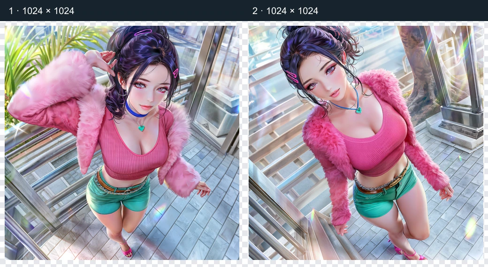
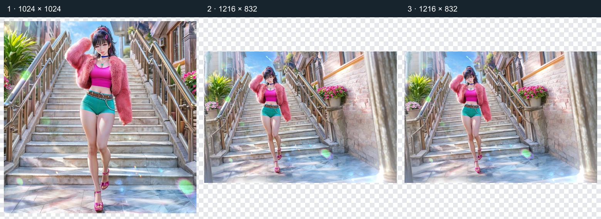

# CHAESSI PRESET v3.8.1

[한국어](v3.8.1.ko.md) · [English](v3.8.1.en.md) · [日本語](v3.8.1.ja.md)

v3.8.0의 카메라 조작을 유지하면서 **방향 표현의 선택과 강도를 분리**했습니다. 도움말의 예제 그림은 사용자 작품과 실제 기능 결과로 교체하고 한국어·영어·일본어 문서를 정비했습니다.

## 카메라: 인접 방향 혼합에서 대표 표현 하나로

| 같은 +40° 목표 | 생성 문구 예시 |
|---|---|
| v3.8.0 v1 | `0.1::front view::, 1.1::three-quarter front view from the right::` |
| v3.8.1 새 v2 작업 | `1.2::three-quarter front view from the right::` |
| 같은 위치에서 사용자 보정 | `1.5::three-quarter front view from the right::` |

- 구체는 연속적으로 움직입니다. 방향 구간마다 대표 표현 하나를 고르며 손잡이를 고정 각도로 뛰게 하지 않습니다.
- 가중치는 선택한 표현의 강도입니다. 방향 사이의 혼합 비율이 아니며 값을 고쳐도 카메라 위치를 역산하지 않습니다.
- 방향뿐 아니라 상하 시점·카메라 높이·프레이밍에서도 한 축의 상충 표현을 정리합니다. 다른 슬롯이나 수동 문구에 남은 조건은 위치와 함께 표시하며 사용자가 검토할 수 있습니다.
- 위치별 보정, 수동 문구, Camera OFF·재연결, 보정 해제·원본 복원·취소를 유지합니다. 보정은 원본·모델/Effort·슬롯·축·표현을 구분합니다.

표의 숫자는 프로그램 동작을 설명합니다. 실제 물리 카메라 각도나 1.2의 보편적 우수성을 보장하지 않습니다.

## 기존 작업을 보존하는 v2 시작

기존 v1 작업과 History는 당시 혼합 규칙으로 다시 엽니다. 단일 방향의 새 작업으로 복사하면 변경 전후를 보고 호환되는 이전 보정만 선택해 가져올 수 있습니다. 취소하면 변경하지 않고, 적용하면 별도 v2 작업을 만듭니다. 가져오기와 되돌리기가 가능하며 v1 원본 기록은 보존됩니다.

## 사용자 작품으로 보는 도움말

42장 구성·검색·문맥 이동·확대 보기를 유지하고, 실제 v3.8.1 UI를 3개국어로 촬영했습니다. 공개 화면의 짧은 문구는 조작 예시이며 원작의 전체 프롬프트·개인 History는 공개하지 않습니다. 구도 편집의 비공개 문구는 화면에서 가렸습니다.

같은 위치·시드에서 방향 강도만 ①1.2 ②1.5로 바꾼 실제 NovelAI 결과입니다. 자세·시선까지 고정되지는 않았습니다.

① 사용자 원본 ② 원본 보존 결과 ③ 같은 응답의 전체 생성 결과. Canvas·Pixel Snap은 실제 로컬 처리이며, Pixel Snap용 블록 격자는 별도로 준비한 입력입니다. 픽셀아트 창작 기능으로 설명하지 않습니다. 이미지 비교의 배치·번호·선택 표시는 설명용 편집입니다.

V5 생성, I2I/Inpaint, 이미지 도구, 구도 편집, Pixel Snap, History, 3개국어 지원 자체는 이전 버전에도 있던 기능입니다. 이번 변경은 카메라 표현 규칙과 기존 기능의 시각 자료·문서 개선입니다.

## 검증과 남은 한계

실제 NovelAI로 카메라·I2I·Inpaint·이미지 도구·구도 편집 예제를 제작했습니다. 코드/mock/Electron 검사는 상태·요청·UI 동작을 확인하며 실제 이미지 품질 시험과 구분합니다. 예제는 제한된 장면의 결과이며 모든 프롬프트의 품질을 보증하지 않습니다.

초기 Sketch의 의상 생략과 배경 인페인트의 인물 중복은 검토 후 입력/문구를 조정했습니다. 동시 생성 잠금으로 거절된 요청은 성공 결과로 처리하지 않았습니다. 카메라 이동으로 인물·자세·시선·배경이 달라질 수 있고, 확장 경계·추가 인물 위치·표정 변화 역시 모델에 좌우됩니다.

이번 후보에서 단위 검사 107개, 기존 회귀 스크립트 21개, 카메라 HTTP 요청 검사 10개와 실제 Electron 검사 106개가 통과했습니다. 도움말 42장 × 3언어의 이미지 표시·확대·검색과 Windows PRIVATE Portable의 새 프로필·저장·재시작을 확인했습니다. 모두 별도 프로필에서 검사했으며 코드/mock 검사는 유료 품질 시험과 별개입니다.

업데이트 전 앱을 종료하고 실제 데이터 폴더를 백업하세요. V4.5 자료는 계속 읽고 편집할 수 있으나 신규 생성은 V5를 선택해야 합니다. [전체 제품 소개](../../README.ko.md) · [카메라 사용법](../../docs/CAMERA.ko.md) · [공식 배포 목록](https://github.com/DooMokDdongGae/Chaessi-Preset/releases)

---

# CHAESSI PRESET v3.8.1

[한국어](v3.8.1.ko.md) · [English](v3.8.1.en.md) · [日本語](v3.8.1.ja.md)

This update keeps the v3.8.0 camera controls while **separating direction selection from expression strength**. Help examples now use user artwork and actual feature results, with revised Korean, English and Japanese documentation.

## One representative expression instead of adjacent-direction blending

| Same +40° target | Example generation text |
|---|---|
| v3.8.0 v1 | `0.1::front view::, 1.1::three-quarter front view from the right::` |
| New v3.8.1 v2 work | `1.2::three-quarter front view from the right::` |
| User correction at the same position | `1.5::three-quarter front view from the right::` |

- The sphere still moves continuously. Each direction sector selects one representative expression; the handle does not jump between fixed angles.
- A weight is expression strength, not a mixture ratio. Editing it does not reverse-calculate a different camera position.
- Elevation, camera height and framing also avoid conflicting expressions within one axis. Conditions remaining in other fields or manual text are shown with their locations for review.
- Position-specific calibration, manual text, Camera OFF/reconnect, disabling calibration, source recovery and undo remain available. Corrections distinguish source, model/Effort, field, axis and expression.

The numbers explain program behavior. They do not guarantee measured camera angles or that 1.2 is universally better.

## Start v2 while keeping existing work

Legacy v1 work and History resume their original blended rules. Copy to new single-direction work shows a before/after preview and lets you select compatible previous corrections. Cancel changes nothing; Apply creates separate v2 work. Import and undo remain available, and original v1 records are retained.

## Help illustrated with user artwork

All 42 chapters retain search, contextual navigation and zoom, with actual v3.8.1 UI captures in three languages. Short public prompts demonstrate controls; full source prompts and personal History are withheld. Private composition text is masked in screenshots.

Actual NovelAI results at the same position and seed, changing only direction strength: ①1.2 ②1.5. Pose and gaze did not stay fixed.

① User source ② Preserved original ③ Full generated result from the same response. Canvas and Pixel Snap examples use actual local processing. The Pixel Snap block grid was prepared separately; it is not presented as creative pixel-art generation. Numbered layouts and selection overlays are explanatory editing.

V5 generation, I2I/Inpaint, image tools, composition, Pixel Snap, History and language support already existed. This release changes camera expression rules and improves the examples and documentation for existing features.

## Validation and remaining limits

Camera, I2I, Inpaint, image-tool and composition examples were produced through actual NovelAI requests. Code, mock and Electron checks cover state, requests and UI behavior separately from image-quality trials. These are limited examples, not a quality guarantee for every prompt.

An initial Sketch omitted clothing details, and an initial background Inpaint duplicated a subject; inputs/text were revised after inspection. A request rejected by a concurrent-generation lock was not counted as a successful result. Camera moves can still change identity, pose, gaze and background. Seams, added subject placement and expression changes also depend on the model.

This candidate passed 107 unit tests, 21 existing regression scripts, 10 camera HTTP checks and 106 actual Electron checks. We checked image display, zoom and search across 42 chapters in three languages, plus a new Windows PRIVATE Portable profile, saving and restart. These isolated code/mock checks are separate from paid image-quality examples.

Close the app and back up the actual data directory before updating. V4.5 records remain readable and editable, but new generation requires V5. [Product overview](../../README.en.md) · [Camera guide](../../docs/CAMERA.en.md) · [Official releases](https://github.com/DooMokDdongGae/Chaessi-Preset/releases)

---

# CHAESSI PRESET v3.8.1

[한국어](v3.8.1.ko.md) · [English](v3.8.1.en.md) · [日本語](v3.8.1.ja.md)

v3.8.0のカメラ操作を保ちながら、**方向表現の選択と強さを分離**しました。ヘルプ例をユーザー作品と実際の機能結果に置き換え、韓国語・英語・日本語の文書を整えました。

## 隣接方向の混合から代表表現一つへ

| 同じ+40°の目標 | 生成文の例 |
|---|---|
| v3.8.0 v1 | `0.1::front view::, 1.1::three-quarter front view from the right::` |
| v3.8.1の新しいv2作業 | `1.2::three-quarter front view from the right::` |
| 同じ位置で手動補正 | `1.5::three-quarter front view from the right::` |

- 球体は連続して動きます。方向区間ごとに代表表現を一つ選び、ハンドルを固定角度へ飛ばしません。
- 重みは表現の強さであり方向間の混合比ではありません。数値を変えてもカメラ位置を逆算しません。
- 上下視点・カメラ高・フレーミングでも一軸内の矛盾表現を整理します。他の欄や手動文章に残る条件は場所とともに表示し、利用者が確認できます。
- 位置ごとの補正、手動文章、Camera OFF・再接続、補正解除、原本復帰、取り消しを維持。原画・モデル/Effort・欄・軸・表現を区別して補正します。

数値はプログラムの動作例です。物理的なカメラ角度や1.2の普遍的な優位性を保証しません。

## 旧作業を保ちながらv2を開始

v1の作業と履歴は当時の混合規則で再開します。単一方向の新しい作業にコピーすると変更前後を確認し、対応する旧補正だけを選んで読み込めます。キャンセルは変更せず、適用は別のv2作業を作ります。読み込みと取り消しに対応し、元のv1記録を保持します。

## ユーザー作品で学ぶヘルプ

42章の構成・検索・関連移動・拡大を保ち、3言語で実際のv3.8.1画面を撮影しました。短い文章は公開用の操作例で、原画のプロンプト全文や個人履歴は公開しません。構図編集の非公開文章欄は隠しています。

位置とシードを同じにし、方向の強さだけ①1.2 ②1.5に変えた実際のNovelAI結果です。姿勢と視線は固定されませんでした。

① ユーザー原画 ② 原画保持 ③ 同じ応答の全生成結果。Canvas・Pixel Snapは実際のローカル処理です。Pixel Snapのブロック格子は別途準備した入力であり、ピクセルアート創作として示しません。番号付き配置と選択表示は説明用の編集です。

V5生成、I2I/Inpaint、画像ツール、構図、Pixel Snap、履歴、3言語対応自体は以前からある機能です。今回の変更はカメラ表現規則と、既存機能の図版・文書の改善です。

## 検証と残る制限

カメラ・I2I・Inpaint・画像ツール・構図の例を実際のNovelAI要求で制作しました。コード・mock・Electron検査は状態・要求・UI動作を確認するもので、画像品質の試験とは区別します。限られた場面の例であり、全プロンプトの品質保証ではありません。

初回Sketchの服の省略と背景Inpaintの人物重複は、確認後に入力と文章を修正しました。同時生成ロックで拒否された要求は成功例に数えていません。カメラ移動で人物・姿勢・視線・背景が変化する場合があり、境界や追加人物の位置、表情もモデルに依存します。

今回の候補で単体テスト107件、既存の回帰スクリプト21件、カメラHTTP検査10件、実際のElectron検査106件が通過しました。42章×3言語の画像表示・拡大・検索とWindows PRIVATE Portableの新規プロファイル・保存・再起動を確認しました。分離したコード/mock検査と有料の画質試験は別です。

更新前に終了し、実際のデータフォルダをバックアップしてください。V4.5資料は読み込み・編集できますが、新規生成にはV5が必要です。[製品紹介](../../README.ja.md) · [カメラガイド](../../docs/CAMERA.ja.md) · [公式リリース](https://github.com/DooMokDdongGae/Chaessi-Preset/releases)
