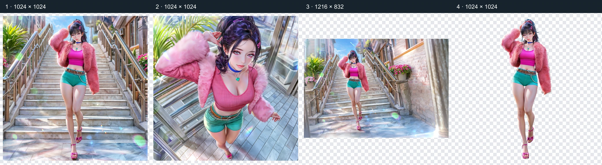
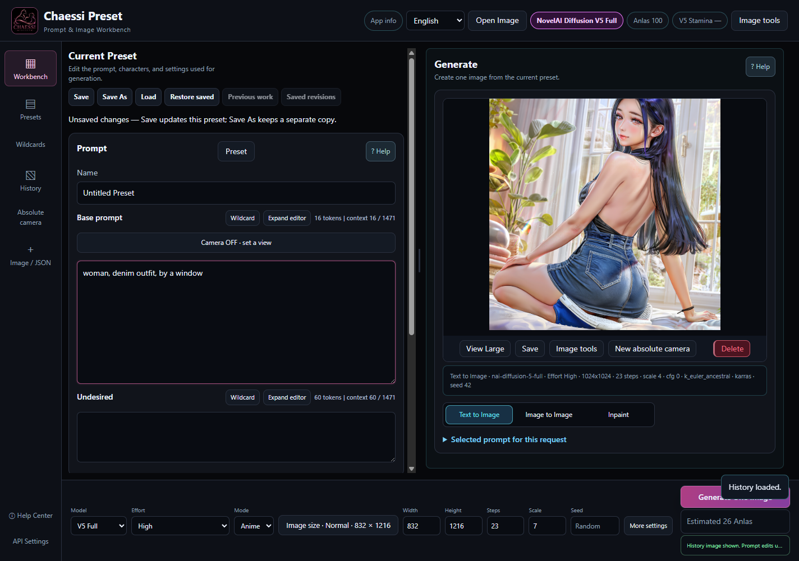
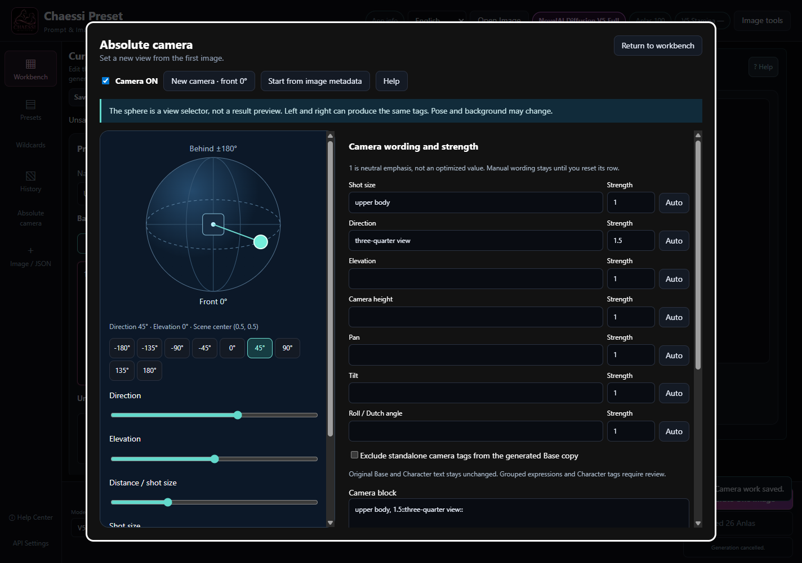

# CHAESSI PRESET v3.8.2

[Windows x64 Portable](https://github.com/DooMokDdongGae/Chaessi-Preset/releases/download/v3.8.2/Chaessi-Preset-v3.8.2-x64.exe) · [SHA256SUMS.txt](https://github.com/DooMokDdongGae/Chaessi-Preset/releases/download/v3.8.2/SHA256SUMS.txt) · [Release](https://github.com/DooMokDdongGae/Chaessi-Preset/releases/tag/v3.8.2)

[한국어](https://github.com/DooMokDdongGae/Chaessi-Preset/blob/main/README.ko.md) · [English](https://github.com/DooMokDdongGae/Chaessi-Preset/blob/main/README.en.md) · [日本語](https://github.com/DooMokDdongGae/Chaessi-Preset/blob/main/README.ja.md)

**[Read all 40 chapters online](https://doomokddonggae.github.io/Chaessi-Preset/v3.8.2/?lang=en&chapter=start)** — This document and online help are maintained for v3.8.2. Help inside the released EXE and documents fixed to the source tag retain their release-time content.

**A local workbench for reusing your prompts, characters, outfits and results across generation and editing.** Generate with your NovelAI account, then organize the materials and continue the work in Chaessi Preset.

“The creator controls and revises the prompts and process to finish the result, instead of asking AI to decide everything.” Saved presets, reviewable generation text, manual weights, source recovery and History reuse serve that purpose.

[v3.8.2 Release](https://github.com/DooMokDdongGae/Chaessi-Preset/releases/tag/v3.8.2) · [Changes in v3.8.2](https://github.com/DooMokDdongGae/Chaessi-Preset/blob/main/.github/releases/v3.8.2.en.md) · [Camera guide](https://github.com/DooMokDdongGae/Chaessi-Preset/blob/main/docs/CAMERA.en.md)

## Continue a piece of work

Build a preset → edit prompts → generate with V5 → inspect → adjust camera and text → use image tools → keep in History → reuse.

**Image provenance:** The workflow below is a historical v3.8.1 example, not an image-quality result from the v3.8.2 camera.

① User source ② actual generation with changed camera text ③ source scaled and rotated with newly generated empty space ④ actual background removal. These are branches from the same source, not one linear processing chain. The camera does not automatically send the selected picture as I2I input.

## Features

| Task | Available controls |
|---|---|
| Reusable materials | Full, Base, Character, negative and settings presets; character/outfit categories and subcategories; search, sorting and Wildcards |
| Editing and recovery | Save / Save As, unsaved indicators, previous work and saved revisions, expanded prompt editor |
| V5 Full generation | High / Medium, one image per request, seed, Character Prompt/Position, text to image, I2I and round-brush Inpaint |
| Camera | Absolute front 0° before the first generation; sphere, direction, elevation, shot size, height, pan, tilt and roll; per-axis weights/manual text; ON/OFF, Base conflict review and separate saved work |
| Expand composition | Move, scale and rotate; extend the frame; automatic gaps and round-brush masks; add characters; review source/masks; compare preserved/full results; restore editing JSON and History |
| Image tools | Upscale, Enhance / Max✨ Enhance, Remove Background, Line Art, Sketch, Colorize, Emotion, Declutter, Outpainting and Focused Inpaint |
| Local editing | Canvas pen, eraser, fill, crop, resize and Undo/Redo; Pixel Snap grid cleanup. Both run locally for 0 Anlas |
| Reuse | History PNGs, settings and operation records; PNG/WebP metadata import; compare, save and hand results to I2I/Inpaint |
| Help | 40 chapters in Korean, English and Japanese, with search, contents, contextual links and image zoom; available offline in the app |

v3.8.2 workbench displaying user-provided help artwork. The text and settings illustrate controls; they are not this artwork’s original generation settings or a result of the new camera.

## Absolute camera in v3.8.2

The camera was rebuilt from v3.7.0. Instead of confirming a source angle and applying relative moves and position-specific corrections as in v3.8.0/3.8.1, you choose an absolute target view relative to front 0°.

The camera is OFF at app startup. **New camera** starts ON at front 0°, elevation 0°, upper body and strength 1. Move the sphere horizontally for direction and vertically for elevation. Shot size, height, pan, tilt and roll have separate controls.

Per-axis strength emphasizes wording; 1 is the default. Manual wording remains until you select Auto for that row. Camera text is added before the Base used for generation. Your editable Base, Character text and Position stay intact.

You can exclude recognized standalone camera tags from the generation Base. This can include a single emphasized tag; multi-tag groups and Character tags remain. Known remaining conflicts require acknowledgement in the final text review. Turn Camera OFF to return to ordinary generation.

Starting a new camera from an image or History starts in T2I at front 0°. Explicitly resuming saved v3.8.2 camera work restores its angles and wording. Work does not resume automatically after restart. Camera work does not save input images or masks: prepare those separately for I2I/Inpaint.

Camera settings send composition and viewpoint instructions to the image model. Results depend on your prompt and the model’s interpretation. Actual NovelAI image quality has not yet been evaluated for the new camera.

Exact 3D rotation, left/right distinction and fixed identity, pose or background are not guaranteed. Both sides may produce the same wording; height, pan and tilt wording is experimental. Read the final text because the app cannot detect every semantic conflict in free prose.

[The new absolute camera](https://github.com/DooMokDdongGae/Chaessi-Preset/blob/main/docs/CAMERA.en.md)

## Generation settings and stored data

High exposes adjustable V5 settings. Medium uses fixed settings and does not apply handwritten Base/Character negative prompts to generation. Your text is retained so you can return to High and use it again.

Presets, History images/settings and camera work are normally stored in `%APPDATA%\Chaessi Preset`. Check the actual folder if you use a custom location. Close the app and back up the whole folder before updating.

The app encrypts saved NovelAI tokens using operating-system protection. Generation and server image tools send the relevant images, text and settings to NovelAI. Canvas, Pixel Snap, saved materials and bundled help are available locally. Optional MCP integration can read saved presets and History.

## Start, update and back up

1. Download the Windows x64 Portable EXE and SHA256SUMS.txt from [Official releases](https://github.com/DooMokDdongGae/Chaessi-Preset/releases).
2. Run the EXE and choose a language. Portable users do not need Node.js. Online work requires your own NovelAI account, token and generation entitlement. In settings, open the NovelAI connection, enter and save your own token, then check the connection status. Treat the token like a password and never share it.
3. Load or write a preset, review High/Medium, size and cost, and generate one image. Continue from the latest result or History with Camera or Image tools. Open App info → Help Center for the controls.
4. Before updating, save edits, close the app and back up the complete actual data directory separately. Keep the data and replace the EXE. To roll back, use the earlier EXE together with a backup appropriate for that version.

Existing presets, categories, Wildcards and History are not batch-converted. V4.5 records remain readable, editable and saveable, but **new V4.5 generation is unsupported: explicitly switch to V5**. Older releases may not understand newer camera/composition records. Automatic updates and automatic recovery of unsaved edits after exit are not provided.

[Update details](https://github.com/DooMokDdongGae/Chaessi-Preset/blob/main/docs/UPDATING.md) · [Third-party notices](THIRD_PARTY_NOTICES.md) · [License](LICENSE)

## Cost and limitations

The app and NovelAI fees are separate. Server requests may use Anlas or V5 Stamina depending on settings and your account. Displayed costs are estimates; large images and small Inpaint masks are not always free. Failed paid requests are not retried automatically.

Custom dimensions must be multiples of 64 and total at most 3,145,728 pixels; they are not rounded automatically. Wallpaper has no Square option. Composition is 2D placement, not 3D reconstruction, a multilayer editor or perspective editing. Pixel Snap cleans an existing grid; it does not create new pixel art from ordinary illustrations. Subject counts, seams, expressions, marker locations and grid suggestions are not guaranteed.

V5 Precise Reference, Vibe Transfer, ControlNet, V5 Curated as a normal generation choice, video and multi-image batches are unsupported. Distribution targets Windows x64; macOS/Linux builds, code signing and automatic updates are not provided. If the unsigned EXE triggers a warning, verify the official source and checksum rather than disabling security protections wholesale.

Keep public artwork copies separate from originals. Check ordinary PNG metadata and hidden alpha-channel generation data. Do not share tokens, personal History, original prompts or the entire data directory.
