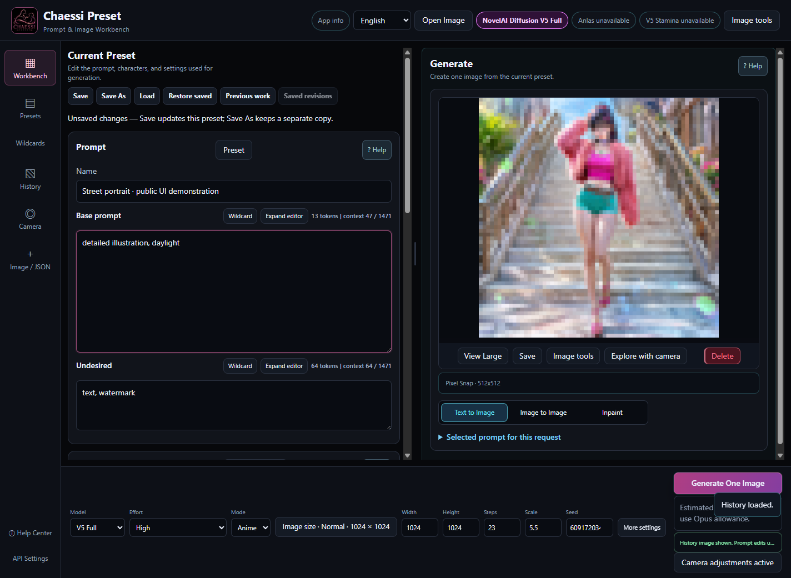

# CHAESSI PRESET v3.8.1

[한국어](README.ko.md) · [English](README.en.md) · [日本語](README.ja.md)

**[Read all 42 chapters online](https://doomokddonggae.github.io/Chaessi-Preset/v3.8.1/?lang=en&chapter=start)** — Browse the same app help in Korean, English and Japanese, with a table of contents, search and full-size images. This website is documentation; image generation runs in the installed app.

**A local workbench for reusing your prompts, characters, outfits and results across generation and editing.** Generate with your NovelAI account, then organize the materials and continue the work in Chaessi Preset.

“The creator controls and revises the prompts and process to finish the result, instead of asking AI to decide everything.” Saved presets, reviewable generation text, manual weights, source recovery and History reuse serve that purpose.

[Official releases](https://github.com/DooMokDdongGae/Chaessi-Preset/releases) · [Changes in v3.8.1](.github/releases/v3.8.1.en.md) · [Camera guide](docs/CAMERA.en.md)

## Continue a piece of work

Build a preset → edit prompts → generate with V5 → inspect → adjust camera and text → use image tools → keep in History → reuse.

① User source ② actual generation with changed camera text ③ source scaled and rotated with newly generated empty space ④ actual background removal. These are branches from the same source, not one linear processing chain. The camera does not automatically send the selected picture as I2I input.

## Features

| Task | Available controls |
|---|---|
| Reusable materials | Full, Base, Character, negative and settings presets; character/outfit categories and subcategories; search, sorting and Wildcards |
| Editing and recovery | Save / Save As, unsaved indicators, previous work and saved revisions, expanded prompt editor |
| V5 Full generation | High / Medium, one image per request, seed, Character Prompt/Position, text to image, I2I and round-brush Inpaint |
| Camera | Start from History, latest result or readable generation metadata; sphere drag, eight directions, pan/tilt, height, framing, roll and aspect ratio; edit weights and text at a position |
| Expand composition | Move, scale and rotate; extend the frame; automatic gaps and round-brush masks; add characters; review source/masks; compare preserved/full results; restore editing JSON and History |
| Image tools | Upscale, Enhance / Max✨ Enhance, Remove Background, Line Art, Sketch, Colorize, Emotion, Declutter, Outpainting and Focused Inpaint |
| Local editing | Canvas pen, eraser, fill, crop, resize and Undo/Redo; Pixel Snap grid cleanup. Both run locally for 0 Anlas |
| Reuse | History PNGs, settings and operation records; PNG/WebP metadata import; compare, save and hand results to I2I/Inpaint |
| Help | 42 chapters in Korean, English and Japanese, with search, contents, contextual links and image zoom; available offline in the app |

Short on-screen prompts are public control examples. Full original prompts and personal History are withheld. Comparisons use real feature results; explanatory layouts and prepared inputs are identified as such.

## Camera in v3.8.1

The handle moves continuously, while each direction, elevation, height and framing axis selects one representative expression. At +40°, for example, it proposes `1.2::three-quarter front view from the right::`. Change it to 1.5 without moving the camera. Weight controls expression strength, not a mixture ratio between directions.

Corrections are stored per source, model/Effort and character field. Keep manual text, turn Camera OFF and reconnect, return only the camera, disable corrections, restore the whole source, or undo. Legacy v1 records resume their original rules. Start separate v2 work and optionally import compatible corrections; old records are not silently converted.

① 1.2 ② 1.5, with the same position and seed. Pose and gaze changed too. This is not a guarantee of physical camera angles or perfectly fixed identity, pose and background. The initial 1.2 is not a validated optimum for every scene.

## Architecture and data

| Component | Role |
|---|---|
| Electron and local Node server | A Windows window displays the HTML/CSS/JavaScript UI. The server handles app requests on 127.0.0.1. The renderer enables contextIsolation and sandbox, with nodeIntegration disabled. |
| Presets | `chaessi-preset/v3` JSON stores Base/negative/Character text, positions and model settings. Earlier readable schemas remain supported. |
| Requests | Editable source text → generation-time resolution including Wildcards → model/mode adapter and validation → NovelAI → image, settings and History. Original text and transmitted expressions remain distinct. |
| Camera | Continuous coordinates, active axes, corrections and manual text are stored as work state; expressions are compiled before generation. v1 and v2 rule versions are recorded separately. |
| High / Medium | High exposes adjustable V5 settings. Medium uses its fixed settings contract and does not apply handwritten Base/Character negatives to the request. The text is retained for returning to High. |
| Local storage | Electron defaults to `%APPDATA%\Chaessi Preset` for presets, History images/settings and camera work. Development or custom data paths may differ. |
| Authentication | Saved Electron tokens use OS-backed safeStorage encryption. Generation and server image tools send the relevant image, text and settings to NovelAI. Local storage does not make every operation offline. |

Relevant code: `electron/`, `server.mjs`, `src/state/`, `src/adapters/`, `src/camera/`, `src/image-tools/` and `src/services/`. The optional MCP server provides read access to saved presets and History.

## Start, update and back up

1. Download the Windows x64 Portable EXE and SHA256SUMS.txt from [Official releases](https://github.com/DooMokDdongGae/Chaessi-Preset/releases).
2. Run the EXE and choose a language. Portable users do not need Node.js. Online work requires your own NovelAI account, token and generation entitlement.
3. Load or write a preset, review High/Medium, size and cost, and generate one image. Continue from the latest result or History with Camera or Image tools. Open App info → Help Center for the controls.
4. Before updating, save edits, close the app and back up the complete actual data directory separately. Keep the data and replace the EXE. To roll back, use the earlier EXE together with a backup appropriate for that version.

Existing presets, categories, Wildcards and History are not batch-converted. V4.5 records remain readable, editable and saveable, but **new V4.5 generation is unsupported: explicitly switch to V5**. Older releases may not understand newer camera/composition records. Automatic updates and automatic recovery of unsaved edits after exit are not provided.

For source development, run `npm ci` then `npm run electron:dev`. `npm start` runs the server; check the development data path. [Update details](docs/UPDATING.md) · [Third-party notices](THIRD_PARTY_NOTICES.md) · [License](LICENSE)

## Cost and limitations

The app and NovelAI fees are separate. Server requests may use Anlas or V5 Stamina depending on settings and your account. Displayed costs are estimates; large images and small Inpaint masks are not always free. Failed paid requests are not retried automatically.

Custom dimensions must be multiples of 64 and total at most 3,145,728 pixels; they are not rounded automatically. Wallpaper has no Square option. Composition is 2D placement, not 3D reconstruction, a multilayer editor or perspective editing. Pixel Snap cleans an existing grid; it does not create new pixel art from ordinary illustrations. Subject counts, seams, expressions, marker locations and grid suggestions are not guaranteed.

V5 Precise Reference, Vibe Transfer, ControlNet, V5 Curated as a normal generation choice, video and multi-image batches are unsupported. Distribution targets Windows x64; macOS/Linux builds, code signing and automatic updates are not provided. If the unsigned EXE triggers a warning, verify the official source and checksum rather than disabling security protections wholesale.

Keep public artwork copies separate from originals. Check ordinary PNG metadata and hidden alpha-channel generation data. Do not share tokens, personal History, original prompts or the entire data directory.
