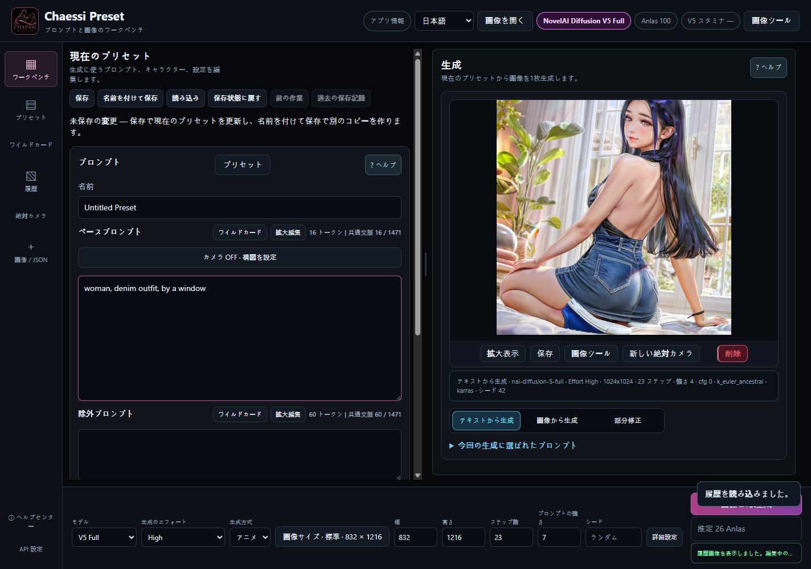
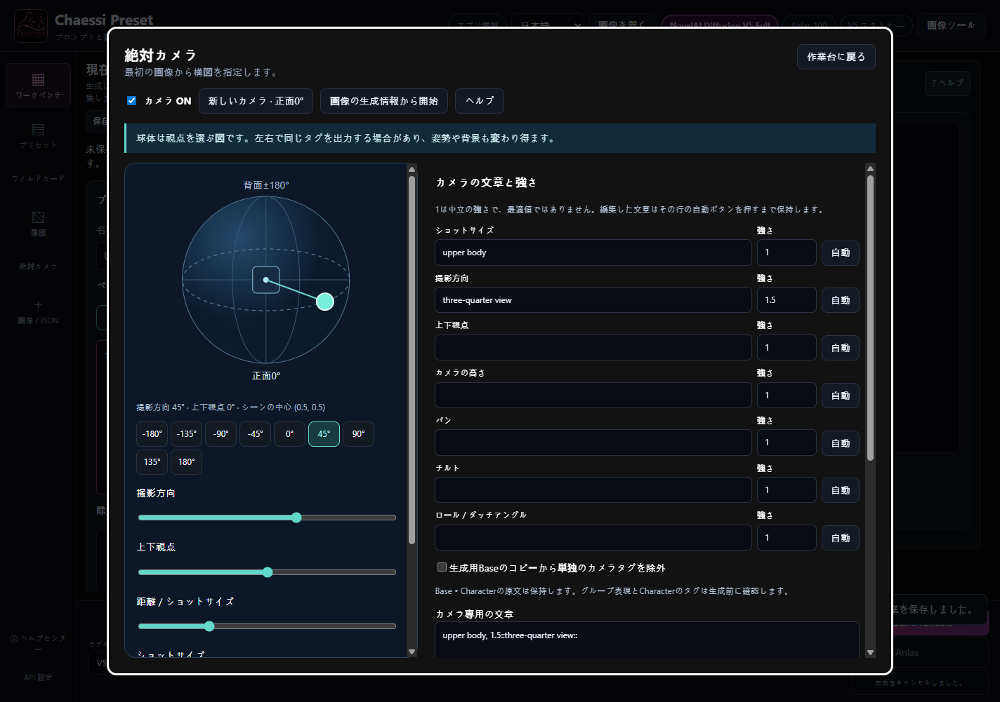

# CHAESSI PRESET v3.8.2

[Windows x64 Portable](https://github.com/DooMokDdongGae/Chaessi-Preset/releases/download/v3.8.2/Chaessi-Preset-v3.8.2-x64.exe) · [SHA256SUMS.txt](https://github.com/DooMokDdongGae/Chaessi-Preset/releases/download/v3.8.2/SHA256SUMS.txt) · [Release](https://github.com/DooMokDdongGae/Chaessi-Preset/releases/tag/v3.8.2)

[한국어](https://github.com/DooMokDdongGae/Chaessi-Preset/blob/main/README.ko.md) · [English](https://github.com/DooMokDdongGae/Chaessi-Preset/blob/main/README.en.md) · [日本語](https://github.com/DooMokDdongGae/Chaessi-Preset/blob/main/README.ja.md)

**[インストールせずに全40章を読む](https://doomokddonggae.github.io/Chaessi-Preset/v3.8.2/?lang=ja&chapter=start)** — この文書とオンラインヘルプは最新の改訂内容を案内します。2026-10-28 改訂 EXE には順番ワイルドカードと更新済みヘルプを含み、既存の v3.8.2 ソースタグは初回公開コミットに固定して保持します。

**自分で作ったプロンプト・人物・衣装・作業結果を再利用し、生成と編集をつなぐローカル作業台です。** NovelAIアカウントで画像を生成し、Chaessi Presetで制作素材と次の作業を管理します。

「AIにすべてを決めさせるのではなく、制作者がプロンプトと工程を自分で制御・修正し、結果を完成させる」。プリセット保存、生成文の確認、重みの手動補正、原本への復帰、履歴の再利用はこの方針のための機能です。

[v3.8.2正式リリース](https://github.com/DooMokDdongGae/Chaessi-Preset/releases/tag/v3.8.2) · [v3.8.2の変更点](https://github.com/DooMokDdongGae/Chaessi-Preset/blob/main/.github/releases/v3.8.2.ja.md) · [カメラガイド](https://github.com/DooMokDdongGae/Chaessi-Preset/blob/main/docs/CAMERA.ja.md)

## 2026-10-28 — ワイルドカード機能追加

既存の管理画面でランダム(Random)または順番(Sequential)を選べます。順番は登録順に繰り返し、次の候補を表示します。生成と履歴の保存が成功した後に1回進み、Sample・プレビュー・キャンセル・失敗では進みません。再起動後も位置を保持し、**最初から**でリセットできます。既存のワイルドカードはランダムのままです。[ワイルドカードのヘルプ](https://doomokddonggae.github.io/Chaessi-Preset/v3.8.2/?lang=ja&chapter=wildcards)

## 作業をつなぐ

プリセット構成 → 文章編集 → V5生成 → 結果確認 → カメラ・文章修正 → 画像ツール → 履歴 → 次の作業へ再利用。

**画像の出所:** 以下のworkflowはv3.8.1の過去の例で、v3.8.2新カメラの画質検証結果ではありません。

① ユーザー原画 ② カメラ文を変更した実生成 ③ 原画を縮小・回転し空白を生成した結果 ④ 実際の背景除去。同じ原画から分岐した例で、一本の連続処理ではありません。カメラは選んだ画像を自動でI2I入力に送りません。

## 主な機能

| 作業 | 使用できる機能 |
|---|---|
| 素材管理 | 全体・Base・Character・除外文・設定プリセット、人物と衣装のカテゴリ・下位分類、検索・並べ替え、Wildcard |
| 編集と復帰 | Save / Save As、未保存表示、前の作業・保存履歴への復帰、長い文章の拡大編集 |
| V5 Full生成 | High / Medium、1回1枚、シード、Character Prompt/Position、テキスト生成・I2I・丸い筆のInpaint |
| カメラ | 初回生成から絶対正面0°、球体・方向・上下・ショット・高さ・パン・チルト・ロール、軸別重み・手動文章、ON/OFF・Base競合確認、独立保存・明示的再開 |
| 構図を広げる | 移動・縮小・回転、枠の拡張、空白の自動マスクと丸い筆、人物追加、送信画像・マスク確認、原画保持/全生成比較、編集JSON・履歴の復元 |
| 画像仕上げ | Upscale、Enhance / Max✨ Enhance、Remove Background、Line Art、Sketch、Colorize、Emotion、Declutter、Outpainting、Focused Inpaint |
| ローカル編集 | Canvasのペン・消しゴム・塗りつぶし・切り抜き・サイズ変更・Undo/Redo、Pixel Snapの格子整理。どちらもローカル0 Anlas |
| 再利用 | 履歴PNG・生成条件・処理記録、PNG/WebPメタデータ読み込み、比較・保存・I2I/Inpaintへの受け渡し |
| ヘルプ | 韓国語・英語・日本語の40章。検索・目次・関連項目移動・画像拡大。アプリ内文書はオフラインで使用可能 |

提供されたヘルプ用作品を表示したv3.8.2の作業画面です。文章と設定は操作の説明用で、この作品の元の生成条件や新カメラの結果を示すものではありません。

## v3.8.2の絶対カメラ

v3.7.0を基にカメラを再構成しました。v3.8.0/3.8.1のように元画像の方向を確認して相対移動や位置別補正を行う方式から、正面0°を基準に目標の視点を指定する方式に変わりました。

起動時のカメラはOFFです。**新しいカメラ**はON・正面0°・上下0°・上半身・強さ1で始まります。球体の横移動で方向、縦移動で上下視点を選びます。ショットサイズ・高さ・パン・チルト・ロールは別々に調整します。

軸ごとの強さは文章を強調する値で、1が初期値です。手動文章は、その行の自動ボタンを押すまで維持されます。カメラ文章は生成用Baseの先頭に追加し、編集中のBase原文・Character文章・Positionは保持します。

生成用Baseから、認識された単独のカメラタグを任意で除外できます。強調した単一タグも対象になる場合がありますが、複数タグをまとめた表現とCharacterタグは残します。既知の競合が残る場合は最終文章の画面で確認が必要です。カメラをOFFにすると通常生成に戻ります。

画像や履歴から新しいカメラを始めると、正面0°のT2Iで開始します。保存済みのv3.8.2カメラ作業を明示的に再開すると角度と文章を復元します。再起動後の自動再開はありません。入力画像とマスクはカメラ作業に保存しないため、I2I/Inpaintでは別途準備してください。

カメラ設定は画像生成モデルに構図や視点の指示を伝えます。実際の結果はプロンプトとモデルの解釈によって変わります。新カメラの実際のNovelAI画質はまだ検証していません。

正確な3D回転、左右の区別、同じ人物・姿勢・背景の維持は保証しません。左右で同じ文章になる場合があり、高さ・パン・チルトの表現は実験的です。自由文の意味上の競合をすべて検出できるわけではないので、最終文章を確認してください。

[新しい絶対カメラ](https://github.com/DooMokDdongGae/Chaessi-Preset/blob/main/docs/CAMERA.ja.md)

## 生成設定とデータの保存

HighではV5設定を調整できます。Mediumは固定設定を使い、手書きのBase・Character除外文を生成に適用しません。入力文章は保持するため、Highに戻って再利用できます。

プリセット、履歴画像・条件、カメラ作業の既定の保存先は `%APPDATA%\Chaessi Preset` です。保存先を指定している場合は実際のフォルダを確認してください。更新前にアプリを終了し、フォルダ全体をバックアップします。

保存するNovelAIトークンはOSの保護機能で暗号化します。生成やサーバー画像処理では必要な画像・文章・設定をNovelAIへ送信します。Canvas、Pixel Snap、保存済み資料の閲覧、アプリ内ヘルプはローカルで使えます。任意のMCP連携で保存済みプリセットと履歴を読み取ることもできます。

## 開始・更新・バックアップ

1. [公式リリース](https://github.com/DooMokDdongGae/Chaessi-Preset/releases)からWindows x64 Portable EXEとSHA256SUMS.txtを取得します。
2. EXEを実行して言語を選びます。Portableに別途Node.jsは不要です。オンライン処理には自分のNovelAIアカウント・トークン・生成権限が必要です。 設定のNovelAI接続で自分のトークンを入力・保存し、接続状態を確認します。トークンはパスワードと同じように扱い、共有しないでください。
3. プリセットを読み込むか文章を書き、High/Medium・サイズ・費用を確認して1枚生成します。最新結果や履歴からカメラ・画像ツールへ進みます。アプリ情報 → ヘルプセンターで操作を確認できます。
4. 更新前に編集を保存して終了し、実際のデータフォルダ全体を別途バックアップします。データを残してEXEを交換します。戻すときは旧EXEとその版に合うバックアップを組み合わせます。

既存プリセット・分類・Wildcard・履歴を一括強制変換しません。V4.5資料は読み込み・編集・保存できますが、**V4.5の新規生成には非対応で、V5へ明示的に切り替える必要があります**。旧版が新しいカメラ・構図記録をすべて理解するとは限りません。自動更新と終了後の未保存編集の自動復旧はありません。

[更新の詳細](https://github.com/DooMokDdongGae/Chaessi-Preset/blob/main/docs/UPDATING.md) · [第三者ライセンス告知](THIRD_PARTY_NOTICES.md) · [ライセンス](LICENSE)

## 費用と制限

アプリの利用とNovelAI料金は別です。サーバー処理は設定と契約に応じてAnlasやV5 Staminaを使います。表示額は推定で、大画像や小さいInpaintマスクが必ず無料になるわけではありません。失敗した有料要求を自動再試行しません。

Customは64の倍数・合計3,145,728画素以下で、自動丸めはしません。Wallpaperに正方形はありません。構図編集は2D配置であり、3D復元・多層編集・遠近編集ではありません。Pixel Snapは既存格子の整理で、通常絵から新しいピクセルアートを創作しません。人数、継ぎ目、表情、マーカー位置、格子推定の精度は保証しません。

V5 Precise Reference、Vibe Transfer、ControlNet、通常生成用V5 Curated選択、動画、複数枚バッチは非対応です。配布対象はWindows x64で、macOS/Linux配布・コード署名・自動更新はありません。未署名EXEの警告が出た場合は公式出所とチェックサムを確認し、保護機能を一括解除しないでください。

公開用作品は原本と別のコピーにします。PNGの通常メタデータに加えアルファチャンネルに隠れた生成情報も確認してください。トークン、個人履歴、原文、データフォルダ全体を共有しないでください。
