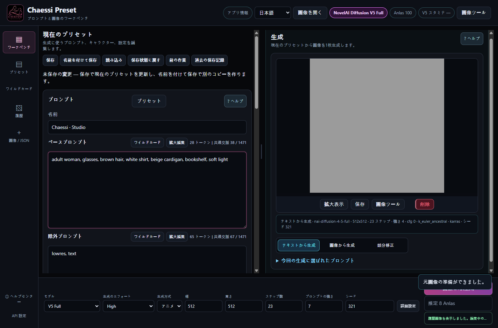

# CHAESSI PRESET v3.8.1

[한국어](README.ko.md) · [English](README.en.md) · [日本語](README.ja.md)

**[インストールせずに全42章を読む](https://doomokddonggae.github.io/Chaessi-Preset/v3.8.1/?lang=ja&chapter=start)** — アプリと同じ説明を韓国語・英語・日本語で読めます。目次・検索・画像の原寸拡大に対応します。このサイトは文書閲覧用で、画像生成はインストールしたアプリで行います。

**自分で作ったプロンプト・人物・衣装・作業結果を再利用し、生成と編集をつなぐローカル作業台です。** NovelAIアカウントで画像を生成し、Chaessi Presetで制作素材と次の作業を管理します。

「AIにすべてを決めさせるのではなく、制作者がプロンプトと工程を自分で制御・修正し、結果を完成させる」。プリセット保存、生成文の確認、重みの手動補正、原本への復帰、履歴の再利用はこの方針のための機能です。

[公式リリース](https://github.com/DooMokDdongGae/Chaessi-Preset/releases) · [v3.8.1の変更点](.github/releases/v3.8.1.ja.md) · [カメラガイド](docs/CAMERA.ja.md)

## 作業をつなぐ

プリセット構成 → 文章編集 → V5生成 → 結果確認 → カメラ・文章修正 → 画像ツール → 履歴 → 次の作業へ再利用。

① ユーザー原画 ② カメラ文を変更した実生成 ③ 原画を縮小・回転し空白を生成した結果 ④ 実際の背景除去。同じ原画から分岐した例で、一本の連続処理ではありません。カメラは選んだ画像を自動でI2I入力に送りません。

## 主な機能

| 作業 | 使用できる機能 |
|---|---|
| 素材管理 | 全体・Base・Character・除外文・設定プリセット、人物と衣装のカテゴリ・下位分類、検索・並べ替え、Wildcard |
| 編集と復帰 | Save / Save As、未保存表示、前の作業・保存履歴への復帰、長い文章の拡大編集 |
| V5 Full生成 | High / Medium、1回1枚、シード、Character Prompt/Position、テキスト生成・I2I・丸い筆のInpaint |
| カメラ | 履歴・最新結果・生成メタデータから開始。球体ドラッグ、8方向、パン・チルト、高さ、フレーミング、ロール、比率、位置ごとの重みと文章編集 |
| 構図を広げる | 移動・縮小・回転、枠の拡張、空白の自動マスクと丸い筆、人物追加、送信画像・マスク確認、原画保持/全生成比較、編集JSON・履歴の復元 |
| 画像仕上げ | Upscale、Enhance / Max✨ Enhance、Remove Background、Line Art、Sketch、Colorize、Emotion、Declutter、Outpainting、Focused Inpaint |
| ローカル編集 | Canvasのペン・消しゴム・塗りつぶし・切り抜き・サイズ変更・Undo/Redo、Pixel Snapの格子整理。どちらもローカル0 Anlas |
| 再利用 | 履歴PNG・生成条件・処理記録、PNG/WebPメタデータ読み込み、比較・保存・I2I/Inpaintへの受け渡し |
| ヘルプ | 韓国語・英語・日本語の42章。検索・目次・関連項目移動・画像拡大。アプリ内文書はオフラインで使用可能 |

画面の短い文章は公開用の操作例です。原画の生成プロンプト全文と個人の履歴は公開しません。比較画像は実際の機能結果で、説明用の配置や準備した入力を生成結果と偽りません。

## v3.8.1のカメラ

球体上の位置は連続して動き、方向・上下視点・高さ・フレーミングの各軸で代表表現を一つ選びます。例えば+40°では `1.2::three-quarter front view from the right::` を提案し、位置を変えず1.5に補正できます。重みは表現の強さであり方向同士の混合比ではありません。

補正は原画・モデル/Effort・人物欄ごとに保存します。文章の手動編集、Camera OFFと再接続、カメラだけの復帰、補正解除、原本全体の復元、取り消しを区別します。以前のv1記録は当時の規則で再開し、別のv2作業に対応する補正だけを選んで読み込めます。旧記録は自動変換しません。

①1.2 ②1.5。位置とシードは同じですが姿勢や視線も変化しました。物理的なカメラ角度や、人物・姿勢・背景の完全固定を保証する機能ではありません。初期値1.2も全場面の最適値として検証された値ではありません。

## 技術構成とデータ

| 構成 | 役割 |
|---|---|
| ElectronとローカルNodeサーバー | WindowsのウィンドウにHTML/CSS/JavaScript UIを表示し、127.0.0.1でアプリの要求を処理。レンダラーはcontextIsolation・sandboxを有効にし、nodeIntegrationを無効にしています。 |
| プリセット | `chaessi-preset/v3` JSONにBase・除外・Character文、位置、モデル設定を保存。読み取り可能な旧スキーマも維持します。 |
| 生成経路 | 編集原文 → Wildcard等の生成時解決 → モデル/モードの変換・検証 → NovelAI → 画像・条件・履歴保存。原文と送信する表現を区別します。 |
| カメラ | 連続座標、操作軸、補正、手動文章を作業状態に保存し、生成前に表現を組み立てます。v1とv2の規則を区別します。 |
| High / Medium | Highは調整可能なV5設定、Mediumは固定設定契約を使い、手書きのBase/Character除外文を送信に適用しません。Highへ戻るための原文は保持します。 |
| ローカル保存 | Electronの既定は `%APPDATA%\Chaessi Preset`。プリセット・履歴画像と条件・カメラ作業を保存します。開発実行や指定パスは異なる場合があります。 |
| 認証 | Electronで保存するNovelAIトークンはOS連携のsafeStorageで暗号化。生成やサーバー画像処理では対象画像・文章・設定をNovelAIへ送ります。ローカル保存は全機能のオフライン実行を意味しません。 |

コードは `electron/`、`server.mjs`、`src/state/`、`src/adapters/`、`src/camera/`、`src/image-tools/`、`src/services/` を参照してください。任意のMCPサーバーは保存済みプリセットと履歴の読み取り用です。

## 開始・更新・バックアップ

1. [公式リリース](https://github.com/DooMokDdongGae/Chaessi-Preset/releases)からWindows x64 Portable EXEとSHA256SUMS.txtを取得します。
2. EXEを実行して言語を選びます。Portableに別途Node.jsは不要です。オンライン処理には自分のNovelAIアカウント・トークン・生成権限が必要です。
3. プリセットを読み込むか文章を書き、High/Medium・サイズ・費用を確認して1枚生成します。最新結果や履歴からカメラ・画像ツールへ進みます。アプリ情報 → ヘルプセンターで操作を確認できます。
4. 更新前に編集を保存して終了し、実際のデータフォルダ全体を別途バックアップします。データを残してEXEを交換します。戻すときは旧EXEとその版に合うバックアップを組み合わせます。

既存プリセット・分類・Wildcard・履歴を一括強制変換しません。V4.5資料は読み込み・編集・保存できますが、**V4.5の新規生成には非対応で、V5へ明示的に切り替える必要があります**。旧版が新しいカメラ・構図記録をすべて理解するとは限りません。自動更新と終了後の未保存編集の自動復旧はありません。

開発実行は `npm ci` の後に `npm run electron:dev`。サーバーのみは `npm start` で、開発用データパスを確認してください。[更新の詳細](docs/UPDATING.md) · [第三者ライセンス告知](THIRD_PARTY_NOTICES.md) · [ライセンス](LICENSE)

## 費用と制限

アプリの利用とNovelAI料金は別です。サーバー処理は設定と契約に応じてAnlasやV5 Staminaを使います。表示額は推定で、大画像や小さいInpaintマスクが必ず無料になるわけではありません。失敗した有料要求を自動再試行しません。

Customは64の倍数・合計3,145,728画素以下で、自動丸めはしません。Wallpaperに正方形はありません。構図編集は2D配置であり、3D復元・多層編集・遠近編集ではありません。Pixel Snapは既存格子の整理で、通常絵から新しいピクセルアートを創作しません。人数、継ぎ目、表情、マーカー位置、格子推定の精度は保証しません。

V5 Precise Reference、Vibe Transfer、ControlNet、通常生成用V5 Curated選択、動画、複数枚バッチは非対応です。配布対象はWindows x64で、macOS/Linux配布・コード署名・自動更新はありません。未署名EXEの警告が出た場合は公式出所とチェックサムを確認し、保護機能を一括解除しないでください。

公開用作品は原本と別のコピーにします。PNGの通常メタデータに加えアルファチャンネルに隠れた生成情報も確認してください。トークン、個人履歴、原文、データフォルダ全体を共有しないでください。
