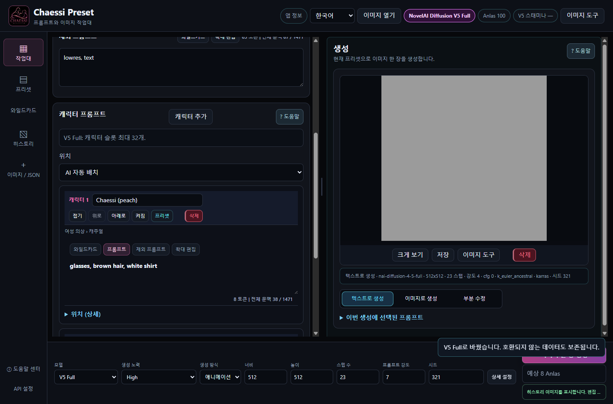

# CHAESSI PRESET v3.8.1

[한국어](README.ko.md) · [English](README.en.md) · [日本語](README.ja.md)

**[설치 없이 보는 42장 온라인 도움말](https://doomokddonggae.github.io/Chaessi-Preset/v3.8.1/?lang=ko&chapter=start)** — 앱과 같은 내용을 한국어·영어·일본어로 읽고, 목차·검색·이미지 확대를 사용할 수 있습니다. 온라인 페이지는 문서 열람용이며 실제 생성은 설치한 앱에서 실행합니다.

**직접 만든 프롬프트·캐릭터·의상·작업 결과를 재사용하면서 생성과 편집을 이어가는 로컬 작업대입니다.** NovelAI 계정으로 그림을 만들고, Chaessi Preset에서 제작 재료와 다음 작업을 관리합니다.

“AI가 모든 것을 자동으로 결정하는 것이 아니라, 창작자가 프롬프트와 작업 과정을 직접 통제하고 수정하면서 결과를 완성한다.” 프리셋 저장, 생성 전 문구 확인, 수동 가중치 보정, 원본 복귀와 History 재사용은 이 방향을 위한 기능입니다.

[공식 배포 목록](https://github.com/DooMokDdongGae/Chaessi-Preset/releases) · [v3.8.1 변경사항](.github/releases/v3.8.1.ko.md) · [카메라 안내](docs/CAMERA.ko.md)

## 한 작업을 이어가기

프리셋 구성 → 프롬프트 편집 → V5 생성 → 결과 확인 → 카메라·문구 수정 → 이미지 도구 → History → 다음 작업에 재사용.

① 사용자 원본 ② 카메라 문구를 바꾼 실제 새 생성 ③ 원본을 축소·회전하고 빈 공간을 생성한 결과 ④ 실제 배경 제거. 모두 하나의 선형 처리 순서는 아니며 같은 원본에서 갈라지는 작업 예입니다. 카메라는 이미지 자체를 자동 I2I로 전송하지 않습니다.

## 주요 기능

| 작업 | 할 수 있는 일 |
|---|---|
| 제작 재료 관리 | 전체·Base·Character·제외 프롬프트·설정 프리셋, 캐릭터·의상 분류와 하위 분류, 검색·정렬, Wildcard |
| 직접 편집과 복귀 | Save / Save As, 미저장 표시, 이전 작업·저장 기록 복원, 긴 프롬프트 확대 편집 |
| V5 Full 생성 | High / Medium, 한 장 생성, Seed, Character Prompt·Position, Text to Image / I2I / 기존 붓 Inpaint |
| 카메라 | History·최근 결과·생성 메타데이터 이미지에서 시작, 구체 드래그·8방향·팬·틸트·높이·프레이밍·롤·화면 비율, 위치별 강도와 문구 직접 수정 |
| 구도 넓히기 | 이미지 이동·축소·회전, 프레임 확장, 빈 공간 자동 마스크·둥근 붓, 캐릭터 추가, 전송 이미지·마스크 확인, 원본 보존/전체 생성 비교, 편집 JSON·History 복원 |
| 이미지 완성 | Upscale, Enhance / Max✨ Enhance, Remove Background, Line Art, Sketch, Colorize, Emotion, Declutter, Outpainting, Focused Inpaint |
| 로컬 편집 | Canvas 펜·지우개·채우기·자르기·크기 변경·Undo/Redo, Pixel Snap 격자 정돈. 두 기능은 로컬 0 Anlas |
| 결과 재사용 | History PNG·생성 조건·이미지 도구 기록, PNG/WebP 메타데이터 읽기, 결과 비교·저장·I2I/Inpaint 연결 |
| 도움말 | 한국어·영어·일본어 42장, 검색·목차·문맥 이동·그림 확대. 앱 내 문서는 오프라인 사용 가능 |

화면의 짧은 프롬프트는 조작 설명용입니다. 사용자 원작의 전체 프롬프트와 개인 History는 공개하지 않습니다. 비교 그림은 실제 기능 결과이며, 단순 화면 배치나 입력 준비를 생성 결과로 표시하지 않습니다.

## v3.8.1 카메라

구체는 연속적으로 움직이고, 방향·상하·높이·프레이밍의 각 축은 대표 표현 하나를 선택합니다. 예를 들어 +40°에서 `1.2::three-quarter front view from the right::`를 제안하며, 같은 위치에서 1.5로 보정할 수 있습니다. 가중치는 표현 강도이며 방향 사이의 혼합 비율이 아닙니다.

원본별·모델/Effort별·캐릭터 슬롯별 보정을 저장합니다. 문구 직접 수정, Camera OFF·재연결, 카메라만 복귀·보정 해제·원본 전체 복원·취소를 구분합니다. 이전 v1 작업은 당시 방식으로 재개하고, 별도 v2 작업에 맞는 보정만 선택해 가져올 수 있습니다. 기존 기록은 자동 변환하지 않습니다.

① 1.2 ② 1.5. 위치·시드는 같지만 자세·시선도 달라졌습니다. 물리 카메라 각도, 동일 인물·포즈·배경의 완전한 고정을 보장하는 기능은 아닙니다. 1.2가 모든 장면의 최적값으로 검증된 것도 아닙니다.

## 기술 구조와 데이터

| 구성 | 실제 역할 |
|---|---|
| Electron + 로컬 Node 서버 | Windows 창에서 HTML/CSS/JavaScript UI를 표시하고, 서버는 127.0.0.1에서 앱 요청을 처리합니다. 렌더러는 contextIsolation·sandbox를 사용하며 nodeIntegration은 꺼져 있습니다. |
| 프리셋 | `chaessi-preset/v3` JSON에 Base·제외·Character 문구와 위치·모델 설정을 보관합니다. 읽을 수 있는 이전 스키마도 유지합니다. |
| 생성 경로 | 편집 원문 → Wildcard 등 생성용 해석 → 모델/모드 어댑터·검증 → NovelAI 요청 → 이미지·조건·History 저장. 원문과 실제 전송 표현을 구분합니다. |
| 카메라 | 연속 좌표·선택 축·사용자 보정·수동 문구를 작업 상태로 보관하고 생성 직전에 표현을 만듭니다. v1과 v2 규칙을 구분해 저장합니다. |
| High / Medium | High는 조절 가능한 V5 설정을 사용합니다. Medium은 고정된 설정 계약을 사용하고 직접 쓴 Base/Character 제외 프롬프트를 전송에 적용하지 않습니다. High로 돌아갈 원문은 보관합니다. |
| 로컬 보관 | 기본 Electron 데이터는 `%APPDATA%\Chaessi Preset`에 있으며 프리셋·History 이미지·조건·카메라 작업은 로컬에 저장됩니다. 개발 실행이나 사용자 지정 데이터 경로는 다를 수 있습니다. |
| 인증 | Electron에서 저장한 NovelAI 토큰은 OS와 연동된 safeStorage로 암호화합니다. 이미지 생성·서버 도구를 실행하면 해당 이미지·문구·설정을 NovelAI에 전송합니다. 로컬 저장이 모든 작업의 오프라인 실행을 뜻하지는 않습니다. |

코드를 살펴볼 때는 `electron/`, `server.mjs`, `src/state/`, `src/adapters/`, `src/camera/`, `src/image-tools/`, `src/services/`를 확인하세요. 선택적으로 제공하는 MCP 서버는 저장된 프리셋·History를 읽는 용도입니다.

## 시작·업데이트·백업

1. [공식 배포 목록](https://github.com/DooMokDdongGae/Chaessi-Preset/releases)에서 Windows x64 Portable EXE와 SHA256SUMS.txt를 받습니다.
2. EXE를 실행하고 언어를 고릅니다. Portable 실행에는 별도 Node.js 설치가 필요 없습니다. 온라인 생성에는 본인의 NovelAI 계정·토큰과 사용 권한이 필요합니다.
3. 프리셋을 선택하거나 글을 쓰고 High/Medium·크기·비용을 확인해 한 장을 생성합니다. 최근 결과나 History에서 카메라 또는 이미지 도구로 이어갑니다. 앱 정보 → 도움말 센터에서 실제 조작을 확인하세요.
4. 업데이트 전 필요한 편집을 저장하고 앱을 종료한 뒤 실제 데이터 폴더 전체를 별도 백업합니다. 데이터는 유지하고 EXE를 교체합니다. 되돌릴 때는 이전 EXE와 그 버전에 맞는 백업을 함께 사용합니다.

기존 프리셋·분류·Wildcard·History를 강제로 일괄 변환하지 않습니다. V4.5 자료는 읽기·편집·저장할 수 있지만 **신규 V4.5 생성은 지원하지 않으므로 V5로 명시적으로 전환**해야 합니다. 구버전이 새 카메라·구도 기록을 모두 이해한다고 가정하지 마세요. 자동 업데이트와 종료 후 미저장 편집 자동 복구는 제공하지 않습니다.

개발 실행은 저장소에서 `npm ci`, `npm run electron:dev`를 사용합니다. 서버만 실행할 때는 `npm start`이며 개발 환경의 데이터 경로를 확인하세요. [업데이트 상세](docs/UPDATING.md) · [서드파티 고지](THIRD_PARTY_NOTICES.md) · [라이선스](LICENSE)

## 비용과 한계

앱 사용과 NovelAI 이용료는 별개입니다. 서버 요청에는 설정과 계정에 따라 Anlas 또는 V5 Stamina가 사용될 수 있습니다. 표시된 비용은 예상값이며 큰 이미지나 작은 인페인트 마스크가 항상 무료는 아닙니다. 실패한 유료 요청은 자동 재시도하지 않습니다.

Custom 크기는 64의 배수·총 3,145,728픽셀 이하이고 자동 반올림하지 않습니다. Wallpaper Square는 없습니다. 구도 편집은 2D 이미지 배치이며 3D 복원·다중 레이어·원근 편집기가 아닙니다. Pixel Snap은 기존 격자 정돈이며 일반 그림을 새로운 픽셀아트로 창작하지 않습니다. 인원수·배경 연결·표정·마커 위치·자동 격자 추천의 정확도는 보장하지 않습니다.

V5 Precise Reference, Vibe Transfer, ControlNet, 일반 생성용 V5 Curated 선택, 영상·다중 배치 생성은 지원하지 않습니다. 현재 배포 대상은 Windows x64이며 macOS/Linux 배포·코드 서명·자동 업데이트는 제공하지 않습니다. 미서명 EXE의 보안 경고가 나타나면 공식 출처와 체크섬을 확인하고 보안 기능을 일괄 해제하지 마세요.

공개용 작품은 원본과 별도 사본으로 보관하세요. PNG의 일반 메타데이터뿐 아니라 알파 채널에 숨겨진 생성 정보도 확인해야 합니다. 토큰·개인 History·원본 프롬프트·전체 데이터 폴더를 공유하지 마세요.
