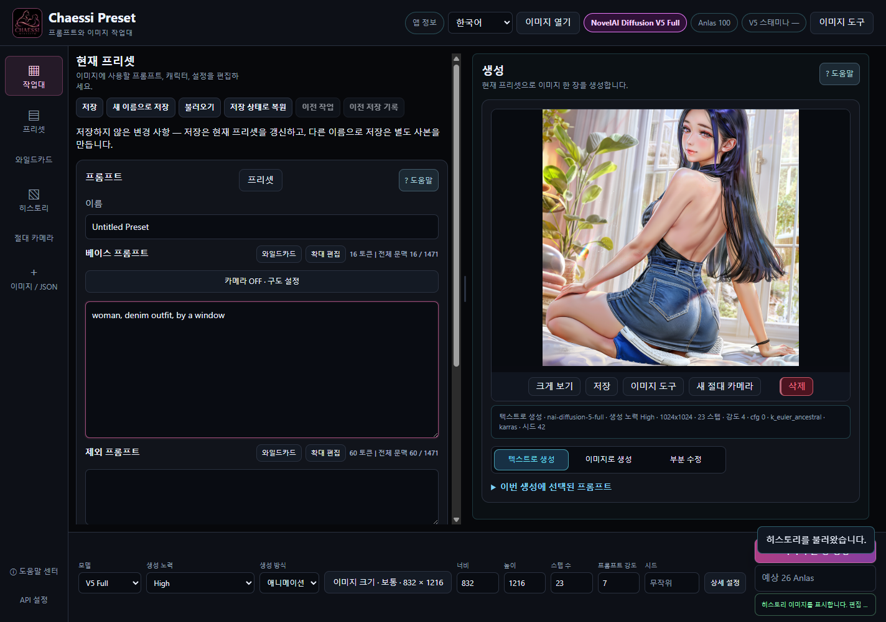
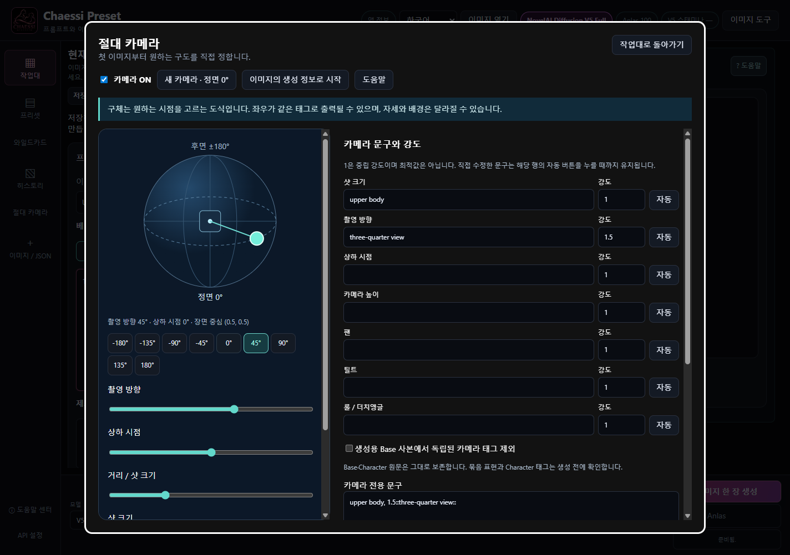

# CHAESSI PRESET v3.8.2

[Windows x64 Portable](https://github.com/DooMokDdongGae/Chaessi-Preset/releases/download/v3.8.2/Chaessi-Preset-v3.8.2-x64.exe) · [SHA256SUMS.txt](https://github.com/DooMokDdongGae/Chaessi-Preset/releases/download/v3.8.2/SHA256SUMS.txt) · [Release](https://github.com/DooMokDdongGae/Chaessi-Preset/releases/tag/v3.8.2)

[한국어](https://github.com/DooMokDdongGae/Chaessi-Preset/blob/main/README.ko.md) · [English](https://github.com/DooMokDdongGae/Chaessi-Preset/blob/main/README.en.md) · [日本語](https://github.com/DooMokDdongGae/Chaessi-Preset/blob/main/README.ja.md)

**[설치 없이 보는 40장 온라인 도움말](https://doomokddonggae.github.io/Chaessi-Preset/v3.8.2/?lang=ko&chapter=start)** — 이 문서와 온라인 도움말은 최신 개정 내용을 안내합니다. 2026-10-28 개정 EXE에는 Wildcard 순차 선택과 갱신된 도움말이 포함되며, 기존 v3.8.2 소스 태그는 최초 배포 커밋으로 보존됩니다.

**직접 만든 프롬프트·캐릭터·의상·작업 결과를 재사용하면서 생성과 편집을 이어가는 로컬 작업대입니다.** NovelAI 계정으로 그림을 만들고, Chaessi Preset에서 제작 재료와 다음 작업을 관리합니다.

“AI가 모든 것을 자동으로 결정하는 것이 아니라, 창작자가 프롬프트와 작업 과정을 직접 통제하고 수정하면서 결과를 완성한다.” 프리셋 저장, 생성 전 문구 확인, 수동 가중치 보정, 원본 복귀와 History 재사용은 이 방향을 위한 기능입니다.

[v3.8.2 정식 Release](https://github.com/DooMokDdongGae/Chaessi-Preset/releases/tag/v3.8.2) · [v3.8.2 변경사항](https://github.com/DooMokDdongGae/Chaessi-Preset/blob/main/.github/releases/v3.8.2.ko.md) · [카메라 안내](https://github.com/DooMokDdongGae/Chaessi-Preset/blob/main/docs/CAMERA.ko.md)

## 2026-10-28 Wildcard 기능 추가

Wildcard 관리에서 무작위(Random) 또는 순차(Sequential)를 선택할 수 있습니다. 순차는 등록 순서를 반복하며 다음 후보를 표시합니다. 생성과 History 저장이 성공한 뒤 한 번 진행하고, Sample·미리보기·취소·실패는 순번을 소비하지 않습니다. 재시작 후에도 순번을 유지하며 **처음부터**로 초기화할 수 있습니다. 기존 Wildcard는 계속 Random입니다. [Wildcard 도움말](https://doomokddonggae.github.io/Chaessi-Preset/v3.8.2/?lang=ko&chapter=wildcards)

## 한 작업을 이어가기

프리셋 구성 → 프롬프트 편집 → V5 생성 → 결과 확인 → 카메라·문구 수정 → 이미지 도구 → History → 다음 작업에 재사용.

**그림 출처:** 아래 workflow는 v3.8.1의 과거 예제이며 v3.8.2 신규 카메라 결과가 아닙니다.

① 사용자 원본 ② 카메라 문구를 바꾼 실제 새 생성 ③ 원본을 축소·회전하고 빈 공간을 생성한 결과 ④ 실제 배경 제거. 모두 하나의 선형 처리 순서는 아니며 같은 원본에서 갈라지는 작업 예입니다. 카메라는 이미지 자체를 자동 I2I로 전송하지 않습니다.

## 주요 기능

| 작업 | 할 수 있는 일 |
|---|---|
| 제작 재료 관리 | 전체·Base·Character·제외 프롬프트·설정 프리셋, 캐릭터·의상 분류와 하위 분류, 검색·정렬, Wildcard |
| 직접 편집과 복귀 | Save / Save As, 미저장 표시, 이전 작업·저장 기록 복원, 긴 프롬프트 확대 편집 |
| V5 Full 생성 | High / Medium, 한 장 생성, Seed, Character Prompt·Position, Text to Image / I2I / 기존 붓 Inpaint |
| 카메라 | 첫 생성부터 절대 정면 0° 시작, 구체·방향·상하·샷 크기·높이·팬·틸트·롤, 축별 강도·수동 문구, ON/OFF·Base 충돌 확인, 별도 저장·명시적 재개 |
| 구도 넓히기 | 이미지 이동·축소·회전, 프레임 확장, 빈 공간 자동 마스크·둥근 붓, 캐릭터 추가, 전송 이미지·마스크 확인, 원본 보존/전체 생성 비교, 편집 JSON·History 복원 |
| 이미지 완성 | Upscale, Enhance / Max✨ Enhance, Remove Background, Line Art, Sketch, Colorize, Emotion, Declutter, Outpainting, Focused Inpaint |
| 로컬 편집 | Canvas 펜·지우개·채우기·자르기·크기 변경·Undo/Redo, Pixel Snap 격자 정돈. 두 기능은 로컬 0 Anlas |
| 결과 재사용 | History PNG·생성 조건·이미지 도구 기록, PNG/WebP 메타데이터 읽기, 결과 비교·저장·I2I/Inpaint 연결 |
| 도움말 | 한국어·영어·일본어 40장, 검색·목차·문맥 이동·그림 확대. 앱 내 문서는 오프라인 사용 가능 |

사용자가 제공한 도움말용 작품을 작업대에 표시한 v3.8.2 화면입니다. 문구와 설정은 조작 설명용이며 이 작품의 원래 생성 조건이나 새 카메라 결과를 나타내지 않습니다.

## v3.8.2 절대 카메라

v3.7.0을 바탕으로 카메라를 새로 구성했습니다. v3.8.0/3.8.1처럼 원본 방향을 확인한 뒤 상대 이동과 위치별 보정을 적용하는 방식에서, 정면 0°를 기준으로 목표 시점을 지정하는 방식으로 바뀌었습니다.

앱을 실행하면 카메라는 OFF입니다. **새 카메라**를 누르면 ON·정면 0°·상하 0°·상반신·강도 1로 시작합니다. 구체를 가로로 움직여 방향을, 세로로 움직여 상하 시점을 고릅니다. 샷 크기와 높이·팬·틸트·롤은 별도로 조절합니다.

축별 강도는 문구의 강조 정도이며 1은 기본값입니다. 수동 문구는 해당 행의 자동 버튼을 누를 때까지 유지됩니다. 카메라 문구는 생성에 사용할 Base 앞에 추가되며 편집 중인 Base 원문, Character 문구와 Position은 보존됩니다.

선택하면 생성용 Base에서 인식된 독립 카메라 태그를 제외할 수 있습니다. 강조된 단일 태그도 해당할 수 있지만 여러 태그를 함께 묶은 표현과 Character 태그는 남습니다. 알려진 충돌이 남으면 최종 문구 확인에서 별도 확인이 필요합니다. OFF로 바꾸면 일반 생성으로 돌아갑니다.

이미지나 History에서 새 카메라를 시작하면 정면 0°의 T2I로 시작합니다. 저장된 v3.8.2 카메라 작업을 직접 재개하면 저장한 각도·문구를 복원합니다. 앱 재시작 후 자동으로 재개하지 않으며 입력 이미지와 마스크는 카메라 작업에 저장하지 않습니다. I2I/Inpaint로 작업할 때는 따로 준비하세요.

카메라 설정은 이미지 생성 모델에 구도와 시점에 관한 지시를 전달합니다. 실제 결과는 프롬프트와 모델의 해석에 따라 달라집니다. 신규 카메라의 실제 NovelAI 이미지 품질은 아직 검증하지 않았습니다.

정확한 3D 회전, 좌우 구별, 동일 인물·포즈·배경 유지는 보장하지 않습니다. 좌우 설정이 같은 문구를 만들 수 있고 높이·팬·틸트 표현은 실험적입니다. 자유 문장의 모든 의미 충돌을 자동으로 찾을 수 없으므로 최종 문구를 읽어 보세요.

[새로운 절대 카메라](https://github.com/DooMokDdongGae/Chaessi-Preset/blob/main/docs/CAMERA.ko.md)

## 생성 설정과 데이터 보관

High에서는 V5 설정을 조절할 수 있습니다. Medium은 정해진 설정을 사용하며 직접 입력한 Base·Character 제외 프롬프트를 생성에 적용하지 않습니다. 입력한 문구는 보관하므로 High로 돌아가 다시 사용할 수 있습니다.

프리셋, History 이미지·조건, 카메라 작업은 기본적으로 `%APPDATA%\Chaessi Preset`에 저장됩니다. 사용자 지정 경로를 쓰는 경우 실제 저장 폴더를 확인하세요. 업데이트 전 앱을 종료하고 폴더 전체를 백업합니다.

저장한 NovelAI 토큰은 운영체제의 보호 기능을 이용해 암호화합니다. 생성이나 서버 이미지 도구를 실행하면 필요한 이미지·문구·설정을 NovelAI로 전송합니다. Canvas와 Pixel Snap, 저장된 자료 열람과 앱 내 도움말은 로컬에서 사용할 수 있습니다. 선택 사항인 MCP 연결로 저장된 프리셋과 History를 읽을 수도 있습니다.

## 시작·업데이트·백업

1. [공식 배포 목록](https://github.com/DooMokDdongGae/Chaessi-Preset/releases)에서 Windows x64 Portable EXE와 SHA256SUMS.txt를 받습니다.
2. EXE를 실행하고 언어를 고릅니다. Portable 실행에는 별도 Node.js 설치가 필요 없습니다. 온라인 생성에는 본인의 NovelAI 계정·토큰과 사용 권한이 필요합니다. 설정의 NovelAI 연결에서 본인 토큰을 입력하고 저장한 뒤 연결 상태를 확인합니다. 토큰은 비밀번호처럼 다루고 공유하지 마세요.
3. 프리셋을 선택하거나 글을 쓰고 High/Medium·크기·비용을 확인해 한 장을 생성합니다. 최근 결과나 History에서 카메라 또는 이미지 도구로 이어갑니다. 앱 정보 → 도움말 센터에서 실제 조작을 확인하세요.
4. 업데이트 전 필요한 편집을 저장하고 앱을 종료한 뒤 실제 데이터 폴더 전체를 별도 백업합니다. 데이터는 유지하고 EXE를 교체합니다. 되돌릴 때는 이전 EXE와 그 버전에 맞는 백업을 함께 사용합니다.

기존 프리셋·분류·Wildcard·History를 강제로 일괄 변환하지 않습니다. V4.5 자료는 읽기·편집·저장할 수 있지만 **신규 V4.5 생성은 지원하지 않으므로 V5로 명시적으로 전환**해야 합니다. 구버전이 새 카메라·구도 기록을 모두 이해한다고 가정하지 마세요. 자동 업데이트와 종료 후 미저장 편집 자동 복구는 제공하지 않습니다.

[업데이트 상세](https://github.com/DooMokDdongGae/Chaessi-Preset/blob/main/docs/UPDATING.md) · [서드파티 고지](THIRD_PARTY_NOTICES.md) · [라이선스](LICENSE)

## 비용과 한계

앱 사용과 NovelAI 이용료는 별개입니다. 서버 요청에는 설정과 계정에 따라 Anlas 또는 V5 Stamina가 사용될 수 있습니다. 표시된 비용은 예상값이며 큰 이미지나 작은 인페인트 마스크가 항상 무료는 아닙니다. 실패한 유료 요청은 자동 재시도하지 않습니다.

Custom 크기는 64의 배수·총 3,145,728픽셀 이하이고 자동 반올림하지 않습니다. Wallpaper Square는 없습니다. 구도 편집은 2D 이미지 배치이며 3D 복원·다중 레이어·원근 편집기가 아닙니다. Pixel Snap은 기존 격자 정돈이며 일반 그림을 새로운 픽셀아트로 창작하지 않습니다. 인원수·배경 연결·표정·마커 위치·자동 격자 추천의 정확도는 보장하지 않습니다.

V5 Precise Reference, Vibe Transfer, ControlNet, 일반 생성용 V5 Curated 선택, 영상·다중 배치 생성은 지원하지 않습니다. 현재 배포 대상은 Windows x64이며 macOS/Linux 배포·코드 서명·자동 업데이트는 제공하지 않습니다. 미서명 EXE의 보안 경고가 나타나면 공식 출처와 체크섬을 확인하고 보안 기능을 일괄 해제하지 마세요.

공개용 작품은 원본과 별도 사본으로 보관하세요. PNG의 일반 메타데이터뿐 아니라 알파 채널에 숨겨진 생성 정보도 확인해야 합니다. 토큰·개인 History·원본 프롬프트·전체 데이터 폴더를 공유하지 마세요.
