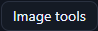
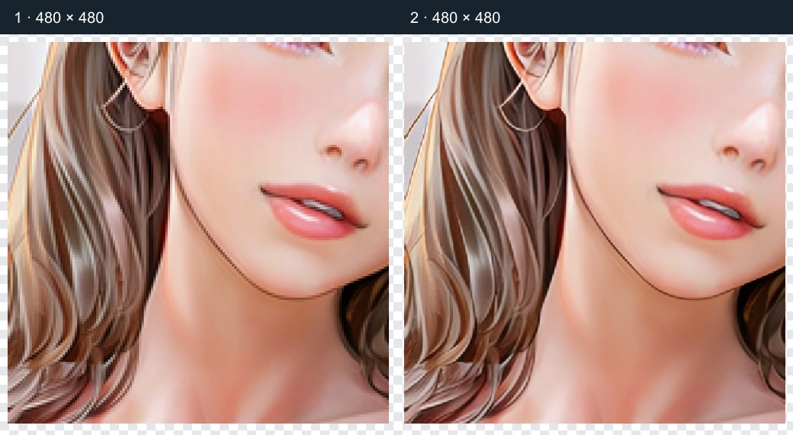
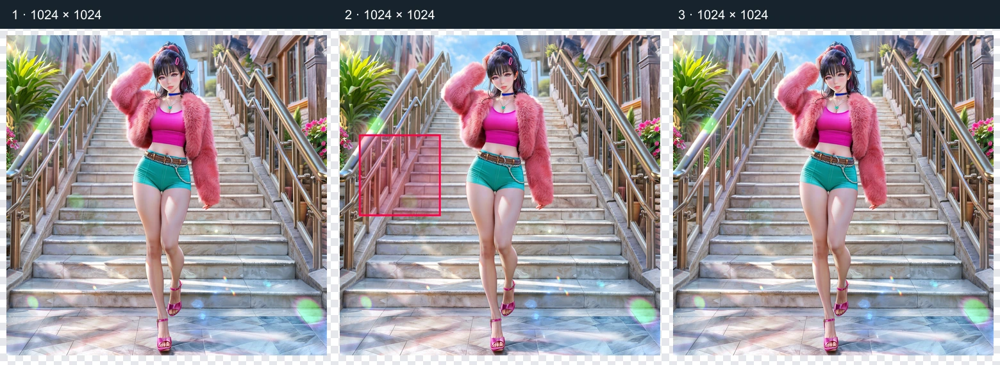

# Chaessi Preset v3.6.0

**프롬프트를 다듬고, 한 장의 PNG를 완성하는 NovelAI 작업대.**<br>
**A NovelAI workbench for refining prompts and finishing one PNG at a time.**<br>
**プロンプトを磨き、1枚の PNG を仕上げる NovelAI 作業台。**

[**⬇ Windows x64 Portable 다운로드 / Download / ダウンロード**](https://github.com/DooMokDdongGae/Chaessi-Preset/releases/download/v3.6.0/Chaessi-Preset-v3.6.0-x64.exe) · [Release Notes](https://github.com/DooMokDdongGae/Chaessi-Preset/releases/tag/v3.6.0) · [Buy Me a Coffee](https://buymeacoffee.com/magiconcert)

설치·Node.js 불필요 · No installer or Node.js required · インストール・Node.js 不要<br>
앱 무료 / Free app / アプリ無料 — NovelAI 계정·이용료 별도 / NovelAI account and usage billed separately / NovelAI のアカウント・利用料金は別途必要

**목차 / Contents / 目次**

- [사용자용 — 한국어](#user-ko)
- [User Guide — English](#user-en)
- [ユーザーガイド — 日本語](#user-ja)
- [개발자용 — 한국어](#developer-ko)
- [Developer Guide — English](#developer-en)
- [開発者ガイド — 日本語](#developer-ja)

| ① Preset | → ② Edit | → ③ Generate PNG | → ④ Image tools | → ⑤ Save |
| --- | --- | --- | --- | --- |
| 불러오기 / Load / 読込 | 수정·저장·복원 / Refine & restore / 編集・復元 | V5 Full High / Medium · 1장 / One image / 1枚 | 확대·보정·부분 수정 / Finish / 仕上げ | 최종 PNG / Final PNG / 完成 PNG |



*실제 앱 화면(계정 수치는 예시): 프롬프트와 PNG를 나란히 확인합니다. 하늘색 선은 Canvas에서 그린 표시입니다. / Actual app (demonstration account values): prompts beside a PNG; the cyan stroke was drawn in Canvas. / 実際の画面（アカウント数値は例）：文章と PNG を並べて確認。水色の線は Canvas で描いたものです。*

<details>
<summary>이미지 완성 예시 / Image finishing examples / 仕上げの例</summary>

**Upscale ×2 — 확대 부분 비교 / Detail comparison / 拡大部分の比較**



1 = 원본 확대 / enlarged source / 元画像の拡大、2 = Upscale 결과 부분 / upscaled detail / Upscale 後の部分。두 패널은 비교용 같은 표시 크기입니다. / Both panels use the same display size for comparison. / 比較用に同じ表示サイズにしています。

**Focused Inpaint — 선택한 부분만 수정 / Edit a selected region / 選んだ範囲を修正**



1 = 원본 / source / 元画像、2 = 선택 영역 설명 / selection guide / 選択範囲の説明、3 = 합성 결과 / result / 合成結果。빨간 사각형은 설명용 표시입니다. / The red rectangle is an instructional overlay. / 赤い四角は説明用の表示です。

예시는 결과를 보장하지 않습니다. 자세한 조작·도구별 비교는 앱 내 Help Center에서 확인하세요. / Results vary; find detailed steps and more comparisons in the in-app Help Center. / 結果は条件により異なります。詳しい手順と比較はアプリ内ヘルプセンターへ。

</details>

<a id="user-ko"></a>
## 사용자용 — 한국어

### 어떤 앱인가요?

CHAESSI PRESET은 NovelAI 이미지 생성을 위한 **프롬프트 관리·편집·복원과 이미지 완성 작업대**입니다. 인물·의상·배경·그림체를 프리셋으로 정리하고, 불러온 글을 고쳐 저장하고, 한 장씩 만든 PNG를 보며 다시 다듬습니다. 마음에 드는 결과는 이미지 도구로 마무리해 PNG로 저장합니다.

v3.5.0의 작업대·라이브러리·다국어 UI를 이어받아 v3.6.0은 **V5 Full High/Medium, 저장·복원·Revisions, 이미지 완성 도구**를 더했습니다. 그림 생성과 온라인 이미지 처리에는 본인의 NovelAI 계정과 인터넷 연결이 필요합니다.

### 주요 기능

| 하고 싶은 일 | v3.6.0에서 할 수 있는 일 |
| --- | --- |
| 글을 고치며 저장 | 프롬프트 편집, Save / Save As, 미저장 변경 표시, 저장 상태 복원, Previous work, Saved revisions |
| 재사용할 재료 정리 | 전체·Base·Character 프리셋, 분류·썸네일·검색·정렬, Wildcard 라이브러리와 기존 랜덤 구문 |
| 인물과 구도 구성 | Character Prompt 최대 32개, 접기·켜기·순서 조절, 번호 슬롯별 분류 기억, Position Pad |
| 한 장씩 시험 | NovelAI V5 Full High / Medium, T2I / I2I / 기존 Inpaint, 예상 Anlas 표시 |
| PNG 완성 | Upscale, Enhance, Max✨ Enhance, 디렉터 도구 6종, Canvas, Outpainting, Focused Inpaint |
| 이전 결과 활용 | 생성·이미지 처리 History, 실제 사용 프롬프트 확인·재사용, PNG Import |
| 도움말과 앱 정보 | 새 첫 번째 **앱 정보** 메뉴, 버전·도움말·후원, 한국어·영어·일본어 UI |

프롬프트와 결과를 나란히 보는 작업대, 영역 너비 조절, 작은 창의 화면 전환, 선택한 입력칸 확대와 긴 글 확대 편집도 유지합니다.

### 설치와 실행

1. [v3.6.0 Release](https://github.com/DooMokDdongGae/Chaessi-Preset/releases/tag/v3.6.0)에서 [**Chaessi-Preset-v3.6.0-x64.exe**](https://github.com/DooMokDdongGae/Chaessi-Preset/releases/download/v3.6.0/Chaessi-Preset-v3.6.0-x64.exe)를 받습니다. <strong>126,476,683 bytes (약 120.62 MiB)</strong>인 Windows x64 Portable EXE입니다.
2. 원하는 폴더에 놓고 실행합니다. 별도 설치나 Node.js가 필요하지 않습니다. 자동 업데이트는 제공하지 않습니다.
3. 상단에서 **한국어 / English / 日本語**를 선택합니다. 다음 실행에서도 기억합니다.
4. <strong>API 설정 (API Settings)</strong>에 본인의 NovelAI access token을 저장합니다.
5. 프리셋을 불러오거나 글을 쓰고 **이미지 한 장 생성**을 누릅니다.

파일은 **미서명 실행 파일**이므로 Windows 보안 경고가 나타날 수 있습니다. 공식 저장소의 다운로드인지 확인하고, [SHA256SUMS.txt](https://github.com/DooMokDdongGae/Chaessi-Preset/releases/download/v3.6.0/SHA256SUMS.txt)와 파일의 SHA-256을 비교하세요. 보안 기능을 일괄 해제할 필요는 없습니다. [체크섬 확인 방법](#verify-download)도 참고하세요.

**기존 사용자:** 저장 후 앱을 종료하고 `%APPDATA%\Chaessi Preset`(사용자 지정이면 실제 데이터 폴더)을 백업한 뒤 EXE를 교체하세요. 프리셋·Wildcard·History는 EXE 밖에 저장됩니다. 데이터 전체를 강제 변환하지 않으며 새 저장에는 v3 형식이 쓰일 수 있습니다. 이전 버전으로 돌아갈 때는 이전 EXE와 백업을 함께 사용하세요. [업데이트 안내](docs/UPDATING.md)

### NovelAI 사용 준비

NovelAI 계정에서 이미지 생성이 가능한지, 사용량과 잔액이 충분한지 확인하세요. **API Settings**에 토큰을 입력하고 저장하면 이후 토큰 값은 다시 표시하지 않습니다. **Clear Saved Token**으로 앱에 저장한 토큰을 지울 수 있습니다. 토큰을 다른 사람에게 보내거나 화면에 공개하지 마세요.

토큰은 이 PC의 암호화된 앱 저장소에 보관됩니다. API 인증 오류가 나면 계정 상태와 토큰을 확인하세요. 생성 비용은 NovelAI의 계정·모델·설정에 따라 달라집니다.

### Preset 기본 사용법

1. **Name**에 알아보기 쉬운 이름을 씁니다.
2. **Base Prompt**에는 그리고 싶은 내용을, **Undesired Content**에는 피하고 싶은 내용을 씁니다. 사용자 UC는 High에서 적용되며 Medium에서는 보관만 합니다.
3. 모델, 크기, Steps, Seed 등 설정을 고릅니다. 모르면 기본값부터 시작하세요.
4. **Save**로 전체 작업대를 저장하고, 새 이름으로 남기려면 **Save As**를 씁니다.
5. 저장한 프리셋을 불러오고 **Generate**를 누릅니다.

Base Prompt 옆 **Preset**은 재사용할 문장 모음을 불러오는 버튼입니다. 선택한 항목의 Prompt와 Undesired로 현재 입력을 교체하고, **Name**에 실제 프리셋 이름을 표시합니다. 전체 작업대를 저장하는 Save와는 범위가 다릅니다.

편집칸을 선택하면 넓어지고 확대 편집으로 긴 글을 편하게 고칠 수 있습니다. 생성 결과는 옆에서 계속 확인하며 아래 생성 바와 상세 설정으로 옵션을 조절합니다. 언어 변경·화면 이동·도움말 열기로 현재 프롬프트·설정·이미지 결과가 초기화되지 않습니다. 앱 종료 후 저장하지 않은 편집 내용의 자동 복원은 제공하지 않으므로 종료 전에 저장하세요.

### 저장·복원·Revisions

**Save**는 현재 프리셋을 갱신하고 **Save As**는 원본을 남긴 별도 프리셋을 만듭니다. 미저장 변경 표시로 저장 필요 여부를 확인하세요. **Restore saved**는 마지막 저장·불러오기 상태로, **Previous work**는 직전 작업대 상태와 교대합니다.

덮어쓰기 전 상태는 **Saved revisions**에 남습니다. 이전 기록을 불러와 확인하고 Save로 다시 저장할 수 있습니다. 프리셋 삭제 시 해당 Revisions도 삭제됩니다. Previous work는 현재 실행 중에만 유지되며, 종료 후 미저장 편집을 자동 복구하지 않습니다.

### 프리셋 찾기와 정렬

전체 프리셋과 Character 프리셋에서 검색·카테고리·하위 카테고리 필터와 정렬을 함께 사용할 수 있습니다. **이름순 / 이름 역순 / 최근 수정 / 오래된 수정 / 최근 생성 / 오래된 생성**을 선택하며 선택을 기억합니다.

이름은 현재 UI 언어의 비교 규칙으로 정렬하고 숫자는 자연 순서로 비교합니다. 사용자 프리셋·카테고리 이름과 프롬프트는 번역하지 않습니다. 일본어 한자의 읽는 법을 추측해 이름을 바꾸지 않으며, 날짜가 없는 과거 항목은 가장 오래된 값으로 취급합니다.

### Character / Outfit / Position

**Add Character**로 인물 입력칸을 추가하세요. 각 인물의 Prompt와 Undesired(High에서 적용)를 따로 쓰고, 그 인물 옆 **Preset**에서 저장한 문장을 불러옵니다. 접기·펼치기, 켜기·끄기, 위·아래 이동으로 정리할 수 있습니다.

각 **번호 슬롯**은 마지막으로 선택한 카테고리와 하위 카테고리를 기억합니다. 재시작, 전체 프리셋 불러오기, History 적용 후에도 번호별 선택을 유지하며 직접 다른 카테고리를 고르면 새 선택을 기억합니다. 캐릭터 이름에 따라 이동하는 설정은 아닙니다.

의상은 Character Prompt Preset의 **여성 의상 / 남성 의상** 분류에 저장해 찾아 쓰세요. 두 의상 분류의 하위 목록은 한글 이름 기준 가나다순입니다. **Manage Categories**에서는 분류와 한 단계 하위 분류를 추가할 수 있습니다.

V5에서 **Custom** 위치를 고르면 Position Pad가 나타납니다. 번호가 붙은 점을 끌어서 해당 인물이 자리할 위치를 정하세요. **AI’s Choice**는 위치를 모델에 맡깁니다. 여러 점을 같은 곳에 두면 겹칠 수 있으며, 지정 위치가 결과에 정확히 반영되는 것은 보장되지 않습니다.

### Wildcard: 긴 후보 목록을 쉽게 쓰기

<details>
<summary>Wildcard 만들기·TXT·랜덤 구문 사용법</summary>

1. 왼쪽 <strong>와일드카드 (Wildcards)</strong>에서 새 항목을 만듭니다.
2. Key에 `tops`, Name에 `상의`를 씁니다.
3. 후보를 한 줄에 하나씩 적고 **Save**합니다.

```text
white shirt
black shirt
blue shirt
red shirt
```

4. 프롬프트 옆 **Wildcard** 버튼에서 항목을 선택하고 **Insert**합니다. 직접 `__tops__`를 적어도 됩니다.

```text
1girl, solo, __tops__, __poses__, ||indoors|outdoors||
```

`poses`도 만들어야 위 예제가 동작합니다. 예를 들어 `standing`, `sitting`, `walking`을 각각 한 줄에 저장하세요. Base, Undesired, Character의 입력에서 여러 Wildcard를 함께 사용할 수 있습니다. Medium에서 비활성화된 사용자 UC의 Wildcard는 추첨하지 않습니다.

생성할 때마다 전체 후보 중 하나를 같은 확률로 선택합니다. `blue shirt`가 뽑히면 실제 요청과 History, 결과 이미지의 NovelAI 메타데이터에는 선택된 문장이 들어갑니다. 프리셋에는 `__tops__`가 남아 다음에 다시 뽑을 수 있습니다. 같은 후보가 연속으로 나오는 것도 정상입니다.

- 빈 줄과 같은 후보의 중복은 저장할 때 정리됩니다.
- Key는 영문 소문자·숫자·`-`·`_`로 만듭니다. 저장한 Key는 바꿀 수 없고 Name과 후보는 수정할 수 있습니다.
- **Import TXT / Export TXT**로 긴 목록을 가져오거나 내보내고, **Sample**로 예시 하나를 볼 수 있습니다. Sample은 실제 생성 선택을 고정하지 않습니다.
- 후보 안에 기존 `||A|B||`는 쓸 수 있지만 다른 Wildcard 참조는 넣을 수 없습니다.
- 없는 Key나 빈 목록은 생성 오류를 표시합니다. 다른 PC에서도 프리셋을 쓰려면 같은 Key의 Wildcard 목록을 준비하세요.
- History를 재사용하면 당시 선택된 문장을 사용합니다. 새로 뽑으려면 원래 프리셋을 불러오세요.

</details>

### 생성 방식과 지원 모델

| V5 Full | High | Medium |
| --- | --- | --- |
| T2I / I2I / 기존 Inpaint | 지원 | 지원 |
| 사용자 Base UC / Character UC | 적용 | 적용하지 않음; 입력값은 보존 |
| Steps / Sampler | 지원 범위에서 조절 | 14 / Euler Ancestral 고정 |
| UC preset / CFG Rescale | 조절 가능 | Heavy 고정 / CFG Rescale 미사용 |
| History·PNG Import | High 복원 | Medium 복원 |

High로 돌아가면 보관한 사용자 UC와 High 전용 설정을 다시 사용합니다. Medium은 별도 모델 요청을 사용합니다. Effort는 생성 방식을 바꾸는 선택이며 High가 모든 그림에서 더 좋은 결과를 보장하지는 않습니다.

**Text to Image**는 글로 새 그림을, **Image to Image**는 원본을 바꾼 그림을 만듭니다. I2I는 Strength와 Noise로 변화를 조절합니다. **기존 Inpaint**는 Brush로 칠한 마스크를 다시 그리는 생성 모드입니다. Eraser·Undo·Redo·Clear Mask와 기존 Padding·강도·합성 전략을 유지합니다. 빈 마스크로는 생성하지 않습니다.

**Focused Inpaint는 별도 이미지 도구**입니다. 사각형과 주변 문맥을 잘라 처리하고 선택 영역만 합성하므로 **선택 밖 픽셀을 보존**합니다. 기존 Inpaint를 대체하지 않습니다. 큰 원본에 작은 마스크를 칠했다고 기존 Inpaint가 항상 무료인 것은 아니며 Focused Inpaint도 비용을 확인해야 합니다.

**V4.5 신규 이미지 생성은 종료했습니다.** 기존 V4.5 프리셋·History·PNG 자료는 읽기·편집·저장할 수 있고, 새 생성에는 V5를 선택해야 합니다. 기존 V4.5 전용 설정이 V5에서 그대로 작동하는 것은 아닙니다.

**Open Image**, 붙여넣기, 드래그 앤 드롭으로 PNG/WebP/JPEG를 넣고 사용할 곳을 고릅니다. NovelAI 설정은 메타데이터 가져오기를 직접 선택해야 적용됩니다. PNG Import는 Effort와 실제 생성 정보를 인식하며, 이미지 처리 PNG의 원본 생성 정보와 후처리 도구 정보는 구분합니다.

### PNG를 완성하는 이미지 도구

최근 결과·History·외부 PNG에서 **이미지 도구**를 엽니다. 원본을 남기고 별도 PNG와 History 기록을 만들며, PNG 저장·다른 도구 적용·I2I/Inpaint 재입력으로 이어갈 수 있습니다.

| 도구 | 하는 일 |
| --- | --- |
| **Upscale ×2** | 가로·세로를 각각 2배로 확대 |
| **Enhance** | 프롬프트와 강도를 사용해 원본을 다시 다듬기 |
| **Max✨ Enhance** | 전용 Max 요청으로 확대·보정; 일반 Upscale ×2와 다른 처리 |
| **Remove Background** | 배경 제거 결과를 만들고 제공된 변형 중 선택 |
| **Line Art / Sketch** | 선화 또는 스케치로 변환 |
| **Colorize** | 색 설명을 참고해 채색 |
| **Emotion** | 선택한 표정으로 얼굴 변화 시도 |
| **Declutter** | 말풍선·글자 등의 방해 요소 정리 시도 |
| **기본 Canvas** | 로컬 펜·지우개·채우기·선택·Undo/Redo·크기 변경·자르기·PNG 저장 |
| **Outpainting** | 캔버스 바깥으로 영역을 늘려 생성; 경계 주변이 달라질 수 있음 |
| **Focused Inpaint** | 사각형 부분을 집중 수정하고 선택 밖 픽셀 보존 |

Remove Background부터 Declutter까지는 NovelAI의 **디렉터(Director) 도구 6종**입니다. 실행 전 **예상 Anlas와 출력 크기**를 확인하세요. 계정 이용권·V5 Stamina·서버 가격·동시 사용에 따라 실제 차감과 달라질 수 있습니다. Canvas의 로컬 편집은 NovelAI 생성 비용이 들지 않습니다. 큰 PNG를 저장·열 수 있어도 도구별 크기 제한과 생성 재입력 제한은 별도입니다.

### History

검색·모델/생성 방식 필터·썸네일 크기로 결과를 찾고 그림을 클릭하면 확대해 당시 Prompt와 설정을 확인합니다. 좌우 버튼이나 방향키로 이전·다음 그림을 보세요. 결과를 저장하거나 작업대로 재사용할 수 있습니다.

삭제 버튼은 저장·불러오기와 떨어져 있으며 확인창에서 대상과 영향을 확인하고 취소하거나 실행합니다. History 선택 모드의 일괄 삭제도 유지됩니다. 확인 후 삭제하면 해당 결과와 소유한 관련 파일은 영구 삭제됩니다.

### 앱 안에서 도움말 읽기

왼쪽 **도움말 센터** 또는 상단 첫 번째 **앱 정보 → 도움말 센터**를 엽니다. 한국어·영어·일본어로 **30개 장**, 실제 앱 스크린샷 **90개**와 결과 비교 그림 **13개**, 총 **103개 이미지**를 제공합니다. 103개는 세 언어 화면과 공용 비교 그림을 합친 수입니다.

목차·검색·이전/다음·글자 크기·화면 확대와 기능 옆 **? 도움말**을 사용하세요. 도움말은 오프라인에서도 읽을 수 있고, 닫으면 같은 작업을 이어갑니다. 앱 정보에서 버전과 Buy Me a Coffee도 확인할 수 있습니다. 기존 한국어·영어 PDF 4개는 <strong>이전 PDF 설명서(v3.4.0)</strong>로 보존하며 최신 설명은 Help Center가 기준입니다. 일본어도 Help Center로 제공합니다.

### 커피 한 잔으로 개발 후원

CHAESSI PRESET은 무료로 제공됩니다. 프로그램이 도움이 되었다면 개발자 **DooMokDdongGae**에게 [Buy Me a Coffee](https://buymeacoffee.com/magiconcert)로 **커피 한 잔당 USD $3의 일회성 후원**을 할 수 있습니다. 앱 정보에도 후원 버튼이 있습니다.

후원은 선택사항이며 후원 없이도 모든 기능을 사용할 수 있습니다. 링크는 외부 브라우저에서 열립니다. 후원 페이지에서 금액을 확인하고 일회성 후원을 선택해 주세요. 후원과 NovelAI 이용료는 별개입니다.

### 주의사항

프롬프트와 입력 이미지는 생성 요청에 사용되어 NovelAI로 전송됩니다. 결과 이미지에 프롬프트가 포함될 수 있으니 공유 전에 확인하세요. 토큰과 개인정보를 프롬프트에 쓰지 마세요. History와 프리셋은 로컬 데이터이므로 PC를 바꿀 때 따로 백업해야 합니다.

이 앱은 서명되지 않은 실행 파일이라 Windows가 신뢰 경고를 표시할 수 있습니다. 공식 저장소의 Release 파일인지 확인하세요. V4.5 신규 생성, V5 Precise Reference, Vibe Transfer, ControlNet, V5 Curated, 영상 생성과 다중 이미지 배치 생성은 지원하지 않습니다. MIT 라이선스이며 타사 구성요소 고지는 [THIRD_PARTY_NOTICES.md](THIRD_PARTY_NOTICES.md)에 있습니다.

<a id="user-en"></a>
## User Guide — English

### What is Chaessi Preset?

CHAESSI PRESET is a **prompt management, editing, recovery and image finishing workbench** for NovelAI. Organize characters, outfits, backgrounds and styles as presets; load a prompt, refine it, save it again and inspect one generated PNG at a time. Finish a result with image tools and save your final PNG.

Building on v3.5.0's workbench, libraries and multilingual UI, v3.6.0 adds **V5 Full High/Medium, saved-state recovery and revisions, and image finishing tools**. Generation and online image processing require your own NovelAI account and an internet connection.

### Main features

| Your task | In v3.6.0 |
| --- | --- |
| Refine and save | Prompt editing, Save / Save As, unsaved changes, Restore saved, Previous work, Saved revisions |
| Organize reusable material | Full/Base/Character presets, categories, thumbnails, search, sorting, Wildcard library and existing random syntax |
| Arrange characters | Up to 32 Character Prompts, folding, enable/disable, reordering, category memory per numbered slot, Position Pad |
| Test one image | NovelAI V5 Full High / Medium, T2I / I2I / existing Inpaint, estimated Anlas |
| Finish a PNG | Upscale, Enhance, Max✨ Enhance, six Director tools, Canvas, Outpainting, Focused Inpaint |
| Revisit a result | Generation/processing History, actual resolved prompts and reuse, PNG Import |
| Find help | New first **App info** menu, version/help/support, Korean/English/Japanese UI |

Keep prompts beside results, adjust panel widths, switch views in a smaller window, expand focused fields or open the large text editor.

### Download and run

1. Get [**Chaessi-Preset-v3.6.0-x64.exe**](https://github.com/DooMokDdongGae/Chaessi-Preset/releases/download/v3.6.0/Chaessi-Preset-v3.6.0-x64.exe) from the [v3.6.0 Release](https://github.com/DooMokDdongGae/Chaessi-Preset/releases/tag/v3.6.0): a <strong>126,476,683-byte (about 120.62 MiB)</strong> Windows x64 Portable EXE.
2. Put it in a folder and run it. No installer or Node.js is required. There is no automatic updater.
3. Choose **한국어 / English / 日本語** at the top; your choice is remembered.
4. Save your own NovelAI access token in **API Settings**.
5. Load a preset or write a prompt, then click **Generate one image**.

The EXE is **unsigned**, so Windows may show a security warning. Check that the download comes from this repository and compare its SHA-256 with [SHA256SUMS.txt](https://github.com/DooMokDdongGae/Chaessi-Preset/releases/download/v3.6.0/SHA256SUMS.txt). Do not disable security protections wholesale. See [checksum verification](#verify-download).

**Updating:** save work, close the app and back up `%APPDATA%\Chaessi Preset` (or your customized data folder) before replacing the EXE. Presets, Wildcards and History live outside the executable. There is no forced whole-library conversion; new saves may use schema v3. For rollback, use the old EXE together with your backup. [Update guide](docs/UPDATING.md)

### Prepare NovelAI

Check that your NovelAI account can generate images and has enough available usage or balance. Enter and save your token in **API Settings**; the saved value is not displayed again. **Clear Saved Token** removes the app's saved token. Do not share your token or expose it on screen.

The token is stored in encrypted app storage on this PC. For authentication errors, check your account and token. Generation costs depend on your NovelAI account, model and settings.

### Basic Preset workflow

1. Enter a recognizable **Name**.
2. Write what you want in **Base Prompt** and what to avoid in **Undesired Content** (custom UC applies in High; Medium preserves it without using it).
3. Choose the model, size, Steps, Seed and other settings. Start with defaults if unsure.
4. **Save** stores the full workbench; **Save As** creates a separate named copy.
5. Load a saved preset and click **Generate**.

The **Preset** button beside Base Prompt loads a reusable prompt module. It replaces the current Prompt and Undesired values and displays the loaded preset's actual name in **Name**. Its scope differs from saving the full workbench.

Selecting a field expands it; use the large editor for long text. Keep viewing results beside your editing area, and adjust options in the bottom generation bar or More settings. Language changes, navigation and help keep your current prompts, settings and result. Unsaved edits are not automatically restored after closing the app, so save before quitting.

### Save, restore and revisions

**Save** updates the current preset; **Save As** creates a separate copy. Unsaved changes show an indicator. **Restore saved** returns to the last saved or loaded state; **Previous work** swaps with the preceding workbench state. **Saved revisions** keeps the state before an overwrite: load it, inspect it and Save. Deleting a preset also deletes its revisions. Previous work is session-only; save before quitting.

### Find and sort presets

Combine search, category/subcategory filters and sorting in the full preset library and Character picker. Choose **Name A–Z / Name Z–A / Recently modified / Oldest modified / Recently created / Oldest created**. Your choice is remembered.

Name sorting follows the selected UI language's comparison rules with natural numeric ordering. User preset/category names and prompts are not translated. Japanese kanji readings are not inferred to rewrite names; missing dates in older entries are treated as the oldest values.

### Character / Outfit / Position

Click **Add Character**, give each character its own Prompt and Undesired text, and use its **Preset** button to load saved text. Fold/Expand, On/Off and Up/Down help organize characters.

Each **numbered slot** remembers its last category and subcategory, including after restarting, loading a full preset or applying History. Choosing a different category updates that slot's memory. This preference follows the slot number rather than a character's name.

Store outfits in the Character Prompt Preset categories **여성 의상 / 남성 의상** (female/male clothing). Both subcategory lists sort by their Korean names. **Manage Categories** adds categories and one level of subcategories.

With V5, choose **Custom** positioning to show the Position Pad. Drag each numbered marker to position that character. **AI’s Choice** lets the model decide. Nearby markers may overlap; exact placement in the generated image is not guaranteed.

### Wildcards: use a long candidate list

<details>
<summary>Create a Wildcard, use TXT lists and random syntax</summary>

1. Open **Wildcards** on the left and create an entry.
2. Set Key to `tops` and Name to `Tops`.
3. Enter one candidate per line and click **Save**.

```text
white shirt
black shirt
blue shirt
red shirt
```

4. Click **Wildcard** beside a prompt field, choose the entry and click **Insert**. You can also type `__tops__` directly.

```text
1girl, solo, __tops__, __poses__, ||indoors|outdoors||
```

Create `poses` too for this example to work, with `standing`, `sitting` and `walking` on separate lines. Multiple Wildcards can be used in Base, Undesired and Character fields. Inactive custom UC in Medium is not sampled.

Each generation selects one candidate from the complete list with equal probability. If `blue shirt` is chosen, the selected text goes into the actual request, History and the result's NovelAI image metadata. The preset keeps `__tops__` for future selections. Consecutive repeats are normal.

- Blank lines and duplicate candidates are removed on save.
- Keys use lowercase English letters, numbers, `-` and `_`. Saved keys are fixed; names and candidates can be edited.
- **Import TXT / Export TXT** moves large lists. **Sample** previews one choice without fixing the next generation's selection.
- Candidates may contain existing `||A|B||` blocks, but cannot contain another Wildcard reference.
- Missing keys or empty lists produce a generation error. To use a preset on another PC, prepare Wildcard lists with the same keys there.
- Reusing History uses the text selected at that time. Load the original preset to select again.

</details>

### Generation modes and supported models

| V5 Full | High | Medium |
| --- | --- | --- |
| T2I / I2I / existing Inpaint | Supported | Supported |
| Custom Base UC / Character UC | Applied | Not applied; text is preserved |
| Steps / Sampler | Adjustable within supported settings | Fixed at 14 / Euler Ancestral |
| UC preset / CFG Rescale | Adjustable | Heavy / CFG Rescale not used |
| History / PNG Import | Restores High | Restores Medium |

Switching back to High restores the stored custom UC and High-specific settings. Medium uses a separate model request. Effort changes how generation works; High does not guarantee a better result for every image.

**Text to Image** draws from text. **Image to Image** changes a source image, with Strength and Noise controlling the transformation. **Existing Inpaint** is the generation mode that redraws a brush-painted mask. Eraser, Undo, Redo, Clear Mask and the existing Padding, strength and compositing strategy remain. Empty masks cannot generate.

**Focused Inpaint is a separate image tool.** It crops a rectangle with surrounding context, processes it and composites only the selected area, **preserving pixels outside the selection**. It does not replace existing Inpaint. A small brush mask on a large source does not make existing Inpaint universally free; check costs for Focused Inpaint too.

**New V4.5 generation has ended.** Existing V4.5 presets, History and PNG records remain readable, editable and savable. Choose V5 before generating; old V4.5-specific settings do not automatically become V5 features.

Use **Open Image**, paste or drag-and-drop for PNG/WebP/JPEG intake. NovelAI settings apply only when you explicitly import metadata. PNG Import recognizes Effort and effective generation data, and distinguishes the source generation from later image processing.

### Finish your PNG with image tools

Open **Image tools** from the latest result, History or an external PNG. Keep the source and create a separate PNG and History entry. Save the PNG, chain another tool or use a supported-size result for I2I/Inpaint.

| Tool | What it does |
| --- | --- |
| **Upscale ×2** | Doubles width and height |
| **Enhance** | Refines the source using a prompt and strength |
| **Max✨ Enhance** | Uses a dedicated Max request for enlargement/refinement; different from regular Upscale ×2 |
| **Remove Background** | Creates background-removal results and lets you choose a supplied variant |
| **Line Art / Sketch** | Converts the picture into line art or a sketch |
| **Colorize** | Adds color guided by a color description |
| **Emotion** | Attempts to change a face to the chosen expression |
| **Declutter** | Attempts to remove distractions such as speech bubbles or text |
| **Basic Canvas** | Local pen, eraser, fill, selection, Undo/Redo, resize, crop and PNG saving |
| **Outpainting** | Generates beyond the canvas; pixels near the boundary may change |
| **Focused Inpaint** | Edits a rectangle while preserving pixels outside the selection |

Remove Background through Declutter are the **six NovelAI Director tools**. Review **estimated Anlas and output dimensions** before execution. Allowances, V5 Stamina, server prices and concurrent account use can make the actual charge differ. Local Canvas edits incur no NovelAI generation cost. Saving/opening a large PNG does not remove per-tool or generation-input size limits.

### History

Find results with search, model/mode filters and thumbnail sizes. Click a picture to enlarge it and inspect its Prompt and settings. Use navigation buttons or arrow keys to browse, save results or reuse them in the workbench.

Delete controls are separated from Save/Load. Read the target and impact in the confirmation dialog, then cancel or delete. History selection mode still supports bulk deletion. Confirming permanently removes results and their owned related files.

### Read help inside the app

Open **Help Center** on the left or the first top menu, **App info → Help Center**. Korean, English and Japanese guides cover **30 chapters**, with **90 actual app screenshots + 13 result comparisons = 103 images** across the three language sets and shared examples.

Use contents, search, previous/next, text size, image zoom and contextual **? Help** links. Help works offline; closing it returns to your work. App info also shows the version and Buy Me a Coffee. Four Korean/English PDFs are preserved as <strong>Previous PDF manuals (v3.4.0)</strong>; the Help Center is the current guide, including Japanese.

### Support development with a coffee

CHAESSI PRESET is free to use. If it helps you, you can support developer **DooMokDdongGae** with **a one-time donation of USD $3 per coffee** through [Buy Me a Coffee](https://buymeacoffee.com/magiconcert). App Info also has the support button.

Support is optional. All features are available without donating. The link opens in your external browser; check the amount and choose one-time support on that page. Donations and NovelAI usage charges are separate.

### Notes

Prompts and input images are used in generation requests sent to NovelAI. Result images may contain prompts, so inspect them before sharing. Never put tokens or personal information in prompts. History and presets are local data and need a separate backup when moving PCs.

The executable is unsigned, so Windows may show a trust warning. Check that it came from the official repository's Release. New V4.5 generation, V5 Precise Reference, Vibe Transfer, ControlNet, V5 Curated, video generation and multi-image batch generation are unsupported. The app uses the MIT license; see [THIRD_PARTY_NOTICES.md](THIRD_PARTY_NOTICES.md) for third-party notices.

<a id="user-ja"></a>
## ユーザーガイド — 日本語

### どんなアプリですか？

CHAESSI PRESET は、NovelAI のための**プロンプト管理・編集・復元と画像仕上げの作業台**です。人物・衣装・背景・画風をプリセットに整理し、読み込んだ文章を直して保存。1枚ずつ生成した PNG を見ながら調整し、画像ツールで仕上げて保存できます。

v3.5.0 の作業台・ライブラリ・多言語 UI を引き継ぎ、v3.6.0 では **V5 Full High/Medium、保存状態の復元と Revisions、画像仕上げツール**を追加しました。生成とオンライン画像処理には、ご自身の NovelAI アカウントとインターネット接続が必要です。

### 主な機能

| やりたいこと | v3.6.0 の機能 |
| --- | --- |
| 文章を磨いて保存 | 編集、Save / Save As、未保存表示、Restore saved、Previous work、Saved revisions |
| 素材を整理 | 全体・Base・Character プリセット、分類・サムネイル・検索・並び替え、Wildcard と従来のランダム構文 |
| 人物と構図を設定 | 最大32個の Character Prompt、折りたたみ・有効切替・順序変更、番号ごとの分類記憶、Position Pad |
| 1枚ずつ試す | NovelAI V5 Full High / Medium、T2I / I2I / 既存 Inpaint、推定 Anlas |
| PNG を仕上げる | Upscale、Enhance、Max✨ Enhance、6種類の Director、Canvas、Outpainting、Focused Inpaint |
| 過去の結果を再利用 | 生成・画像処理の履歴、実際に使用した文章の確認と再利用、PNG Import |
| ヘルプを見る | 先頭の新しい**アプリ情報**メニュー、バージョン・ヘルプ・支援、韓国語・英語・日本語 UI |

文章と結果の並列表示、パネル幅の調整、小さなウィンドウでの表示切替、選択中の入力欄拡大と長文エディターも使えます。

### ダウンロードと起動

1. [v3.6.0 Release](https://github.com/DooMokDdongGae/Chaessi-Preset/releases/tag/v3.6.0) から [**Chaessi-Preset-v3.6.0-x64.exe**](https://github.com/DooMokDdongGae/Chaessi-Preset/releases/download/v3.6.0/Chaessi-Preset-v3.6.0-x64.exe) を取得します。Windows x64 用 Portable EXE、<strong>126,476,683 bytes（約120.62 MiB）</strong>です。
2. 好きなフォルダーに置いて起動します。インストールや Node.js は不要です。自動更新機能はありません。
3. 上部で **한국어 / English / 日本語**を選びます。次回も選択を記憶します。
4. **API Settings** にご自身の NovelAI access token を保存します。
5. プリセットを読み込むか文章を入力し、**画像を1枚生成**を押します。

EXE は**未署名**のため、Windows のセキュリティ警告が出る場合があります。この公式リポジトリのファイルか確認し、[SHA256SUMS.txt](https://github.com/DooMokDdongGae/Chaessi-Preset/releases/download/v3.6.0/SHA256SUMS.txt) と SHA-256 を照合してください。セキュリティ機能を一括で無効にする必要はありません。[照合方法](#verify-download)も参照できます。

**更新する方へ：** 保存して終了し、`%APPDATA%\Chaessi Preset`（独自設定の場合は実際のデータ先）をバックアップしてから EXE を交換します。プリセット・Wildcard・履歴は EXE の外にあります。一括の強制変換は行わず、新規保存には v3 形式を使う場合があります。旧版に戻すときは旧 EXE とバックアップを一緒に使ってください。[更新ガイド](docs/UPDATING.md)

### NovelAI の準備

アカウントで画像生成が可能か、利用枠や残高が十分かを確認します。**API Settings** にトークンを保存すると、保存した値は再表示しません。**Clear Saved Token** で削除できます。トークンを他人に渡したり、画面上で公開したりしないでください。

トークンは、この PC の暗号化されたアプリ保存領域に保管されます。認証エラーの場合はアカウントとトークンを確認してください。生成費用は NovelAI のアカウント・モデル・設定によって変わります。

### プリセットの基本

1. **Name** に分かりやすい名前を入力します。
2. **Base Prompt** に描きたい内容、**Undesired Content** に避けたい内容を書きます（独自 UC は High で適用し、Medium では保持のみ）。
3. モデル、サイズ、Steps、Seed などを選びます。迷ったら既定値から始めてください。
4. **Save** で全体の作業を保存し、別のコピーには **Save As** を使います。
5. プリセットを読み込み、画像を生成します。

Base Prompt の隣の **Preset** は再利用する文章を読み込みます。現在の Prompt と Undesired を選んだ内容に置き換え、実際のプリセット名を **Name** に表示します。全体の作業を保存する機能とは対象範囲が異なります。

選択すると入力欄が広がり、長文は拡大エディターで編集できます。横で結果を見ながら、下部の生成バーと詳細設定で調整してください。言語変更、画面移動、ヘルプでも編集中のプロンプト・設定・結果を維持します。終了後に未保存の編集を自動復元する機能はないため、終了前に保存してください。

### 保存・復元・Revisions

**Save** は現在のプリセットを更新し、**Save As** は元を残して別のプリセットを作ります。未保存の変更は表示で確認できます。**Restore saved** は最後に保存・読み込みした状態へ戻り、**Previous work** は直前の作業状態と入れ替えます。

上書き前の状態は **Saved revisions** に残ります。過去の記録を読み込み、確認して Save で保存できます。プリセットを削除すると、その Revisions も削除されます。Previous work は現在の起動中のみ有効で、終了後の未保存編集の自動復元はありません。

### プリセットの検索と並び替え

全体プリセットと Character の選択画面で、検索、カテゴリ・サブカテゴリの絞り込み、並び替えを組み合わせられます。**名前順 / 名前逆順 / 更新が新しい順 / 更新が古い順 / 作成が新しい順 / 作成が古い順**を選び、選択を記憶します。

名前順は選んだ UI 言語の比較規則を使い、数字も自然な順序で比較します。ユーザーのプリセット名・カテゴリ名・プロンプトは翻訳しません。漢字の読みを推測して名前を変えることはなく、日付のない古い項目は最も古い値として扱います。

### Character / Outfit / Position

**Add Character** で入力欄を作り、それぞれの Prompt と Undesired を書きます。そのキャラクターの **Preset** で保存した文章を読み込めます。折りたたみ・展開、オン・オフ、上・下で整理できます。

各**番号スロット**は最後に選んだカテゴリとサブカテゴリを記憶します。再起動、全体プリセットの読み込み、履歴の適用後も番号ごとに維持します。別のカテゴリを選ぶと更新します。キャラクターの名前に付いて移動する設定ではありません。

衣装は女性・男性衣装のカテゴリ（韓国語表示では **여성 의상 / 남성 의상**）から探せます。この2種類のサブカテゴリは韓国語名の順序を維持します。**Manage Categories** ではカテゴリと1段階のサブカテゴリを追加できます。

V5 で **Custom** の配置を選ぶと Position Pad が表示されます。番号付きの点をドラッグして位置を指定してください。**AI's Choice** ではモデルが決めます。近い点は重なる場合があり、正確な位置反映は保証されません。

### ワイルドカード：1行に1つの候補

<details>
<summary>Wildcard の作成・TXT・ランダム構文の使い方</summary>

1. 左の **Wildcards** で新しい項目を作ります。
2. 名前を `上着`、キーを `tops` にします。
3. 候補を1行に1つずつ入力して **Save** します。

```text
white shirt
black shirt
blue shirt
red shirt
```

4. プロンプト横の **Wildcard** から選んで挿入するか、直接 `__tops__` と書きます。

```text
1girl, solo, __tops__, __poses__, ||indoors|outdoors||
```

この例では `poses` も作り、`standing`、`sitting`、`walking` をそれぞれ別の行に保存してください。Base、Undesired、Character で複数のキーを使えます。Medium で無効な独自 UC の候補は抽選しません。

生成ごとに候補全体から1つを同じ確率で選びます。`blue shirt` が選ばれれば、実際のリクエスト、履歴、結果画像の NovelAI メタデータにはその文章が入ります。プリセットには `__tops__` が残り、次の生成で再抽選します。同じ候補が連続する場合もあります。

- 保存時に空行と重複行を除きます。
- キーは英小文字・数字・`-`・`_` を使います。保存後のキーは固定ですが、名前と候補は編集できます。
- **Import TXT / Export TXT** で長いリストを移せます。**Sample** は試しに選ぶ機能で、次回の生成候補を固定しません。
- 候補に `||A|B||` は使えますが、別のワイルドカードは参照できません。
- キーが存在しない場合やリストが空の場合は生成エラーになります。別の PC では同じキーの候補リストも用意してください。
- 履歴の再利用はそのとき選ばれた文章を使います。再抽選には元のプリセットを読み込んでください。

</details>

### 生成方式と対応モデル

| V5 Full | High | Medium |
| --- | --- | --- |
| T2I / I2I / 既存 Inpaint | 対応 | 対応 |
| 独自の Base UC / Character UC | 適用 | 適用せず、文章は保持 |
| Steps / Sampler | 対応範囲で調整可能 | 14 / Euler Ancestral 固定 |
| UC preset / CFG Rescale | 調整可能 | Heavy 固定 / CFG Rescale 未使用 |
| 履歴・PNG Import | High を復元 | Medium を復元 |

High に戻すと、保持した独自 UC と High 用設定を再び使えます。Medium は別モデルへのリクエストを使います。Effort は生成方法の選択であり、High が常に良い結果になるとは限りません。

**Text to Image** は文章から描き、**Image to Image** は元画像を変えます。I2I は Strength と Noise で変化を調整します。**既存 Inpaint** は筆で塗ったマスクを描き直す生成モードです。Eraser・Undo・Redo・Clear Mask と従来の Padding・強さ・合成方式を保ちます。空のマスクでは生成できません。

**Focused Inpaint は別の画像ツール**です。四角い選択と周囲を切り出して処理し、選択内だけを合成して**選択外の画素を保持**します。既存 Inpaint の置き換えではありません。大きな元画像の小さなマスクでも既存 Inpaint が必ず無料になるわけではなく、Focused Inpaint も費用の確認が必要です。

**V4.5 の新規画像生成は終了しました。** 既存の V4.5 プリセット・履歴・PNG 資料は読込・編集・保存できます。新しい生成には V5 を選んでください。V4.5 専用設定がそのまま V5 で使えるわけではありません。

**Open Image**、貼り付け、ドラッグ＆ドロップで PNG/WebP/JPEG を取り込めます。NovelAI 設定はメタデータの読込を明示的に選んだ場合だけ適用します。PNG Import は Effort と実際の生成値を認識し、加工 PNG の元の生成情報と後処理情報を区別します。

### PNG を仕上げる画像ツール

最新結果・履歴・外部 PNG から**画像ツール**を開きます。元画像を残して別の PNG と履歴を作り、PNG 保存・別ツール適用・対応サイズの画像の I2I/Inpaint 再入力へ進めます。

| ツール | できること |
| --- | --- |
| **Upscale ×2** | 幅と高さをそれぞれ2倍に拡大 |
| **Enhance** | 文章と強さを使って元画像を描き直し・調整 |
| **Max✨ Enhance** | 専用 Max リクエストで拡大・調整。通常の Upscale ×2 とは別の処理 |
| **Remove Background** | 背景を除去し、提供された結果の種類を選択 |
| **Line Art / Sketch** | 線画またはスケッチに変換 |
| **Colorize** | 色の説明を参考に彩色 |
| **Emotion** | 選んだ表情への変更を試行 |
| **Declutter** | 吹き出しや文字などの邪魔な要素の除去を試行 |
| **基本 Canvas** | ローカルのペン・消しゴム・塗りつぶし・選択・Undo/Redo・サイズ変更・切り抜き・PNG 保存 |
| **Outpainting** | キャンバス外へ生成して拡張。境界付近は変わる場合あり |
| **Focused Inpaint** | 四角い範囲を修正し、選択外の画素を保持 |

Remove Background から Declutter までが NovelAI の**6種類の Director ツール**です。実行前に**推定 Anlas と出力サイズ**を確認します。利用枠・V5 Stamina・価格変更・同時利用により実際の差引と異なる場合があります。Canvas のローカル編集には NovelAI 生成費用がかかりません。大きな PNG を保存・表示できても、各ツールや生成入力のサイズ上限は別です。

### 履歴と削除

検索、モデル/生成方式の絞り込み、サムネイルサイズで結果を探します。画像を押すと拡大し、そのときの Prompt と設定を確認できます。移動ボタンや矢印キーで前後を見て、保存や作業台での再利用ができます。

削除ボタンは保存・読み込みから離して配置しています。確認画面で対象と影響を読み、キャンセルまたは削除します。履歴の選択モードによる一括削除も使えます。確定すると結果とそれに属する関連ファイルを完全に削除します。

### アプリ内のヘルプを読む

左の**ヘルプセンター**、または上部先頭の**アプリ情報 → ヘルプセンター**を開きます。韓国語・英語・日本語の **30章**と、実際の画面 **90枚＋結果比較13枚＝合計103枚**を収録しています。103枚は3言語の画面と共通の比較を合わせた数です。

目次・検索・前/次・文字サイズ・画像拡大・機能横の **? ヘルプ**を使えます。オフラインでも読め、閉じると作業を続けられます。アプリ情報にはバージョンと Buy Me a Coffee もあります。従来の韓国語・英語 PDF 4個は<strong>以前の PDF 説明書（v3.4.0）</strong>として保管し、最新版と日本語の説明は Help Center で提供します。

### コーヒー1杯で開発を応援

CHAESSI PRESET は無料で利用できます。役に立ったら、開発者 **DooMokDdongGae** を [Buy Me a Coffee](https://buymeacoffee.com/magiconcert) で**コーヒー1杯あたり USD $3 の単発の支援**で応援できます。アプリ情報にも支援ボタンがあります。

支援は任意です。支援しなくてもすべての機能を利用できます。リンクは外部ブラウザーで開きます。支援ページで金額を確認し、単発の支援を選んでください。支援と NovelAI の利用料金は別です。

### 注意事項

プロンプトと入力画像は生成リクエストで NovelAI に送信されます。結果画像にプロンプトが含まれる場合があるため共有前に確認してください。プロンプトにトークンや個人情報を書かないでください。PC を変えるときはローカルのプリセット・ワイルドカード・履歴を別途バックアップしてください。

実行ファイルは未署名のため Windows の警告が表示される場合があります。公式リポジトリの Release から取得したか確認してください。V4.5 の新規生成、V5 Precise Reference、Vibe Transfer、ControlNet、V5 Curated、動画生成、複数画像のバッチ生成には対応していません。MIT ライセンスで、第三者の告知は [THIRD_PARTY_NOTICES.md](THIRD_PARTY_NOTICES.md) にあります。

<a id="verify-download"></a>
## SHA-256 확인 / Verify your download / ダウンロードの照合

[SHA256SUMS.txt](https://github.com/DooMokDdongGae/Chaessi-Preset/releases/download/v3.6.0/SHA256SUMS.txt) · EXE: **126,476,683 bytes / 120.62 MiB**

```powershell
Get-FileHash .\Chaessi-Preset-v3.6.0-x64.exe -Algorithm SHA256
```

Expected SHA-256 / 예상값 / 期待値:

```text
c88af21277c605687bc66ba160164a7e9fa775d5569b37b5309c0f0f6d0d0ac4
```

<a id="developer-ko"></a>
## 개발자용 — 한국어

v3.5.0의 개발 환경·Electron 구조·저장소·Wildcard·payload·빌드·검증·다국어·도움말·후원·Release 안내는 [**개발자 가이드**](DEVELOPMENT.md#developer-ko)에 보존하고 v3.6.0에 맞췄습니다.

Node.js 22 이상, npm, Git으로 시작합니다. 일반 사용자는 위 Portable EXE만 받으면 됩니다.

```powershell
npm ci
npm run electron:dev
```

[변경 이력](CHANGELOG.md) · [검증 범위](VERIFICATION.md) · [읽기 전용 MCP](mcp/README.md) · [MIT 라이선스](LICENSE) · [타사 고지](THIRD_PARTY_NOTICES.md) · [이미지 자산 고지](assets/manuals/ASSET_NOTICES.md)

<a id="developer-en"></a>
## Developer Guide — English

The v3.5.0 development, Electron architecture, storage, Wildcard, payload, build, verification, localization, help, support and Release guidance is preserved and updated in the [**Developer Guide**](DEVELOPMENT.md#developer-en).

Use Node.js 22 or later, npm and Git. Regular users only need the Portable EXE above.

```powershell
npm ci
npm run electron:dev
```

[Changelog](CHANGELOG.md) · [Verification](VERIFICATION.md) · [Read-only MCP](mcp/README.md) · [MIT license](LICENSE) · [Third-party notices](THIRD_PARTY_NOTICES.md) · [Image asset notices](assets/manuals/ASSET_NOTICES.md)

<a id="developer-ja"></a>
## 開発者ガイド — 日本語

v3.5.0 の開発環境・Electron 構成・保存・Wildcard・payload・ビルド・検証・多言語・ヘルプ・支援・Release の説明は、[**開発者ガイド**](DEVELOPMENT.md#developer-ja)に保存し、v3.6.0 に合わせて更新しています。

Node.js 22 以上、npm、Git を用意します。一般ユーザーは上記 Portable EXE だけで利用できます。

```powershell
npm ci
npm run electron:dev
```

[変更履歴](CHANGELOG.md) · [検証範囲](VERIFICATION.md) · [読取専用 MCP](mcp/README.md) · [MIT ライセンス](LICENSE) · [第三者告知](THIRD_PARTY_NOTICES.md) · [画像素材の告知](assets/manuals/ASSET_NOTICES.md)
