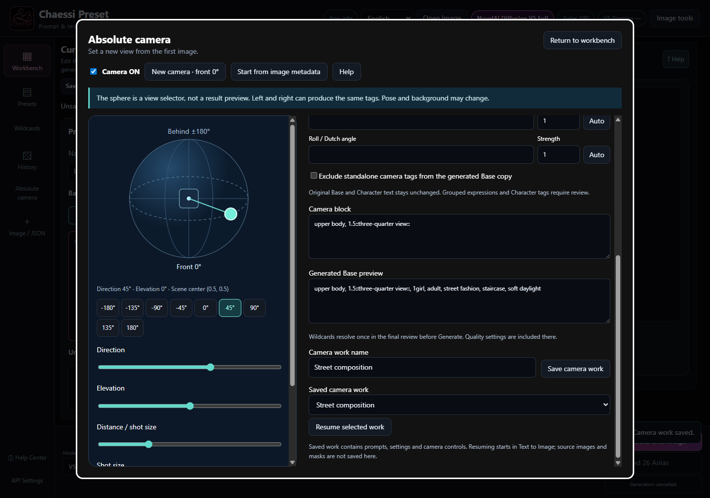
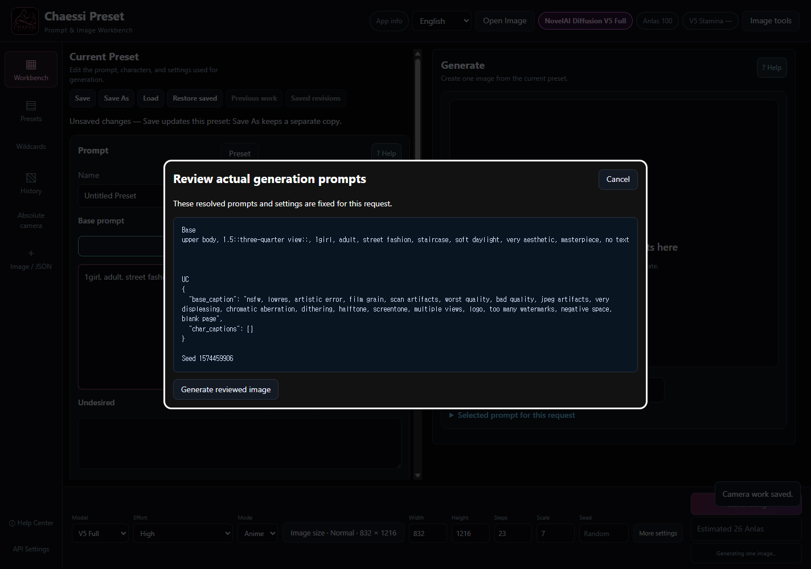
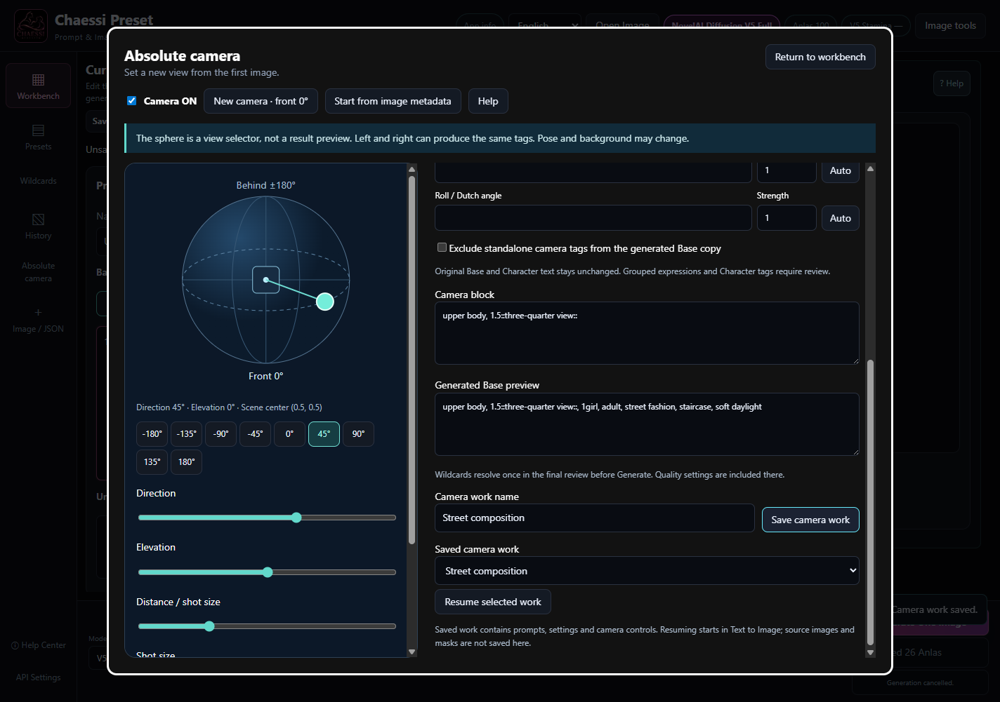

# CHAESSI PRESET v3.8.2

## Absolute camera from the first image

Choose a target view from front 0° for both new and reused images.

1. Prepare Base and Character prompts, then open Absolute camera on the left. No source image is required.
2. Turn Camera ON. New work starts at front 0°, elevation 0°, upper body. The app never asks for the source viewing angle.
3. Drag horizontally for direction and vertically for elevation. Direction buttons and arrow keys also work; Home returns to front.
4. Turn Camera OFF to use the ordinary manual prompt without an added camera block.

The sphere is an input diagram centered on the scene (0.5, 0.5). It does not rotate a physical scene or change Character Position coordinates.

## Direction, shot size and framing

Control independent axes without blending contradictory directions.

1. Direction chooses front, three-quarter front, side, three-quarter rear or behind. Both left and right side may use from side.
2. Use the distance slider or choose close-up, upper body, cowboy shot, full body or wide shot. This describes framing, not meters.
3. Elevation adds from above or from below. The neutral band adds no elevation phrase.
4. Additional framing options expose height, pan, tilt and roll. Image size opens the existing resolution picker. I2I/Inpaint source dimensions remain unchanged.

Exact left/right orientation, physical angles and independent pan/tilt effects are not guaranteed. Height, pan and tilt wording is experimental.

## Base-only wording and direct editing

Keep editing originals separate from the generated Base copy.

1. Camera phrases precede Base in this order: shot, direction, elevation, height, pan, tilt, roll. Character text is never moved or rewritten.
2. Edit each strength between -10 and 10. One is neutral; zero omits that row. Negative emphasis can suppress or invert an idea and may oppose the intended view.
3. Edit wording directly. Manual text survives sphere movement; Auto on that row returns to coordinate-derived wording.
4. An incomplete number such as 1. remains visible and blocks saving/generation. Complete or correct it. Weight edits never move the sphere.

Weights are emphasis, not direction mixing ratios. Neither the initial value 1 nor the wording is established as optimal in real images.

## Manual conflicts and final review

Read and decide which prompts will actually be sent.

1. Explicit camera tags in Base and Character are listed with their locations. Pose, head and gaze prose is not interpreted or deleted.
2. Optionally exclude exact standalone camera tags from the generated Base copy. Originals stay intact; grouped expressions and Character tags remain.
3. Return to the workbench and press Generate. Wildcards resolve once and final prompts include quality and UC. Explicitly check to retain remaining manual expressions, or cancel and edit the originals.
4. Only Generate reviewed image sends the request. Later edits do not change the request already in progress.

The app cannot resolve every semantic conflict in free prose. Read the final text. Functional validation does not establish actual NovelAI image quality.

## Reuse images, History and saved work

Distinguish a new camera from resuming a saved v3.8.2 camera.

1. Start from image metadata accepts a PNG/WebP with readable generation data. It imports prompts/settings and starts a new camera at front 0° without automatic I2I.
2. Open History and choose New absolute camera to start at 0° regardless of the old view. Legacy camera metadata can be inspected read-only.
3. Resume v3.8.2 camera restores its recorded state and original editing prompts. v3.8.0/1 calibration is never converted.
4. Save camera work writes prompts/settings/camera to a separate file. Resume selected work after restarting. Resuming uses Text to Image; prepare source images/masks separately.

Existing presets, History and legacy camera files are not overwritten. The model may change composition, people and backgrounds.
