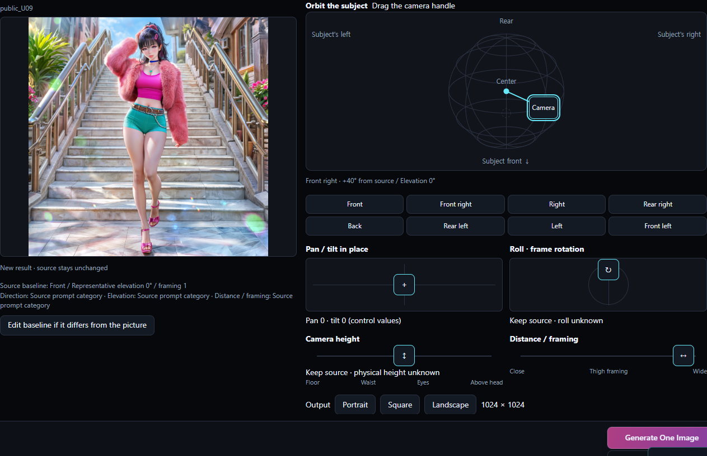
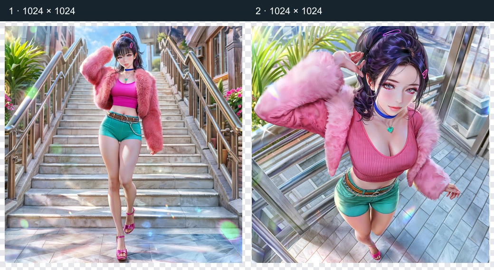
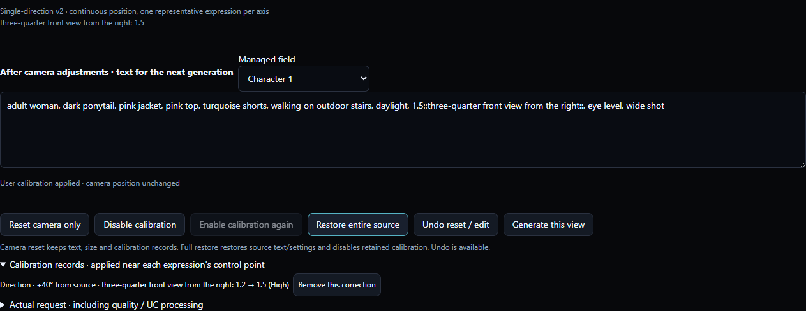
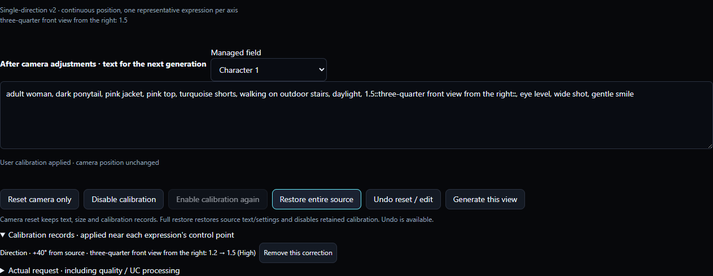

# CHAESSI PRESET v3.8.1 — EN

## Camera: start from an existing image

Explore another composition using an existing image’s prompt and settings. Automatic mapping is a starting point; editing it yourself is a normal part of the workflow.

1. Open a picture in History and press Explore with camera. The same button is available on the latest generation result.
2. For an external PNG/WebP, use Open Image, read its NAI generation metadata, then choose the camera button. Images without readable metadata are not automatically analyzed and their prompts are not guessed.
3. Direction, elevation and framing found in the source text establish the baseline. Confirm only missing or ambiguous information. Use Edit baseline if it differs from the picture to correct it.
4. V4.5 records remain readable and editable. Explicitly switch to V5 Full in the workbench before generating, then check High/Medium and the settings.

This is not 3D reconstruction or an exact reshoot. Selecting an image does not automatically send it as I2I input. Source files and existing History are not overwritten.

Actual v3.8.1 UI with user-provided artwork. Short on-screen prompts demonstrate the controls; the original full prompts are not published.

## Camera: handles and directions

Orbiting and pan/tilt in place describe different camera goals. The diagram is an input control, not a result preview.

1. Drag the camera handle on the sphere to change direction and elevation. The eight buttons select front, both front diagonals, sides, rear diagonals and back; drag to explore intermediate positions. New v2 work stores continuous positions but selects one representative expression for each direction, elevation, height and framing axis. Direction sectors span ±22.5° around each center and include their start but exclude their end. A tag change at a boundary does not snap the handle.
2. Left and right are relative to the subject. They may differ from screen left/right when viewing the subject from the front. Check the displayed change from the source.
3. The pan/tilt pad requests a change in where the camera points while its position stays fixed. Orbiting changes the viewing position around the subject.
4. Height requests physical camera height; distance/framing controls how much is included; roll requests frame rotation. Portrait, square and landscape change actual output dimensions, which can also be edited in generation settings.

No wheel or Shift shortcut is required. Angles are representative targets, not measurements of the generated image. Height and elevation are separate states, but the model may not reflect them independently.

Actual v3.8.1 UI with user-provided artwork. Short on-screen prompts demonstrate the controls; the original full prompts are not published.

① User source ② actual generation with direction +40° and elevation 25° targets. These are not measured physical angles; pose and background changed too.

## Camera: calibrate weights at the current position

Position is your camera target; weight is the strength of an expression. Editing a number does not move the camera by reverse-calculating an angle.

1. In new v2 work, +40° from a front baseline proposes one front-diagonal expression at 1.2. In After camera adjustments · text for the next generation, change that number to 1.5. The initial 1.2 is a comparison baseline, not a validated optimum.
2. The camera stays at +40°. At +50° the correction continues within the same diagonal sector; +90° selects one side expression. Returning to +40° reproduces 1.5. Adjacent directions are not mixed and weights are not converted back to angles.
3. You can correct multiple positions. Editing the same expression at the same position replaces that correction. Repeated travel does not accumulate values, and a front-diagonal expression does not remain attached at the side or back.
4. Corrections belong to this source’s work, model/Effort, field, axis and expression. They do not propagate to another source. Switching High/Medium uses the records for those conditions. Disable calibration, enable it again or remove an individual correction from the records.

These numbers explain controls; they do not guarantee an actual +40° image. Input supports -10 to 10 and up to 3 decimal places. Changing another axis does not move the corrected axis.

Actual v3.8.1 UI with user-provided artwork. Short on-screen prompts demonstrate the controls; the original full prompts are not published.

Actual results at the same position and seed, with only direction strength changed: ① 1.2 ② 1.5. Pose and gaze did not remain fixed.

## Camera: edit and continue

If the model changes a hand, outfit, background or something that should be hidden, edit the text and continue. This is not replaced with automatic pose or visibility inference.

1. Changing only a managed expression’s number in the next-generation text is calibration. You can also edit identity, outfit, action, pose and background text directly.
2. Adding, deleting or replacing camera tags can conflict with automatic control. The field then uses manual text. Your edit takes priority and moving a handle does not silently overwrite it. Camera conditions left in manual text or other fields are shown with their location. Original text is retained for you to inspect and edit.
3. Press Reconnect camera control for this field to resume panel management. Undo reset / edit recovers the previous text. Disable camera, keep current text transfers the valid output to the ordinary workbench so you can keep editing.
4. Press Generate this view to send a request. Edits during generation apply to the next request; the sent request retains its starting snapshot. Actual request shows text after existing quality/UC processing.

Weight calibration and structural text editing are different actions. Fix or cancel incomplete syntax before generating. Releasing a handle or editing text never generates automatically.

Actual v3.8.1 UI with user-provided artwork. Short on-screen prompts demonstrate the controls; the original full prompts are not published.

## Camera: recover from invalid input

An input error does not delete your work. Fix it or cancel the edit and continue.

1. An unfinished number such as 1. or an unclosed :: remains visible and blocks generation. Complete it or press Cancel current incomplete edit. Undo reset / edit can recover the canceled input.
2. Zero and negative values are accepted within -10 to 10. They may suppress an expression; they do not mean camera movement. Follow the error guidance for out-of-range values or excessive decimal places.
3. If movement exceeds the supported range in legacy v1 or pan/tilt/roll calibration, reduce the value, remove that correction or disable calibration. Values are not silently clipped.
4. A mixed weight group may be held to protect non-camera content. Edit its structure yourself or use manual text. Restore entire source starts again from the original conditions and can be undone.

You can switch sources or continue ordinary work without camera application. An error never causes an old valid value to be sent as though it were your latest input.

Actual v3.8.1 UI with user-provided artwork. Short on-screen prompts demonstrate the controls; the original full prompts are not published.

## Camera: compare, save and restore

Source-specific work and generated results are stored separately. A new result is a comparison, not an automatic replacement source.

1. Compare the source and new result on the left. Explicitly choose Use this result as a new source to establish another baseline. This is separate from resuming its saved camera record.
2. Reset camera only returns to the source baseline while retaining text, size and correction records. Disable calibration leaves the position unchanged. Individual corrections can also be removed from the records.
3. Restore entire source restores original text, seed, size and generation settings while retaining disabled corrections. Undo reset / edit undoes the previous reset or restore. Switch sources and return in Working source to resume that source’s work.
4. The local data/camera folder stores source-specific work and selected imported images. Generation History JSON adds camera_context. Resuming this record uses stored camera coordinates instead of estimating angles from corrected weights. Legacy v1 work and History resume the original blended calculation. Copy to a new single-direction work opens a preview where you can select calibrations. Only absolute values matching source, model/Effort, field, expression and position can be imported; unavailable records stay in the original work. Cancel changes nothing; Apply creates a separate v2 work. In v2, Select legacy calibrations to import and Undo reset / edit remain available.

Copying only a normal PNG/WebP may preserve generation metadata but does not carry every camera session and correction. Back up application data and History. Conflicting stored records and actual text are not resumed automatically.

Actual v3.8.1 UI with user-provided artwork. Short on-screen prompts demonstrate the controls; the original full prompts are not published.

## Camera: limits and generation costs

Explore a target position and expression strength. The model cannot preserve every scene condition perfectly.

1. Dragging, editing weights, confirming a baseline and changing aspect ratio do not send generation requests. When you press Generate, follow the existing cost guidance for your account, model and settings.
2. The same seed does not guarantee consistent pose, hands, arms, head, gaze, background or objects. If a result differs from your intent, edit the text or weights and generate again.
3. Independent pan/tilt in place and separation of physical height from elevation can be unstable. Compare one control at a time. Roll does not guarantee an exact image angle or rotation direction either.
4. The gaze experiment is off by default. When enabled and the direction changes sufficiently, it releases only clear looking at viewer constraints while retaining head-pose text such as looking over shoulder. It does not guarantee fixed gaze or head pose.

Live generation requires internet and a NovelAI account with generation access and follows Anlas or V5 Stamina conditions. Generation is not advertised as free. Code, mock and Electron checks are distinct from image-quality testing.

Actual v3.8.1 UI with user-provided artwork. Short on-screen prompts demonstrate the controls; the original full prompts are not published.
