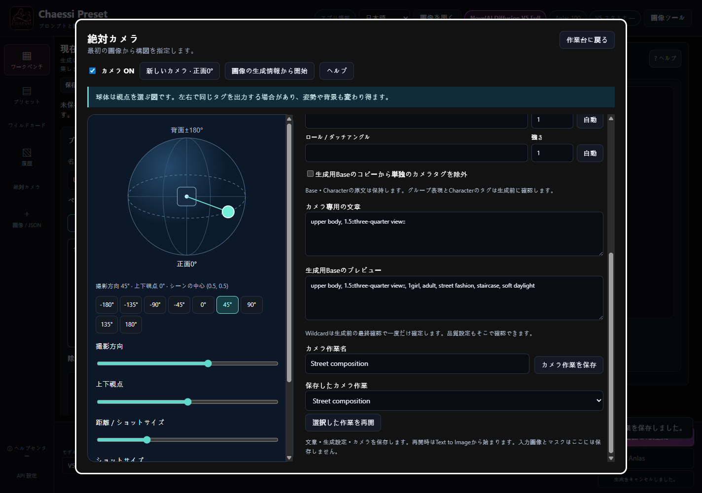
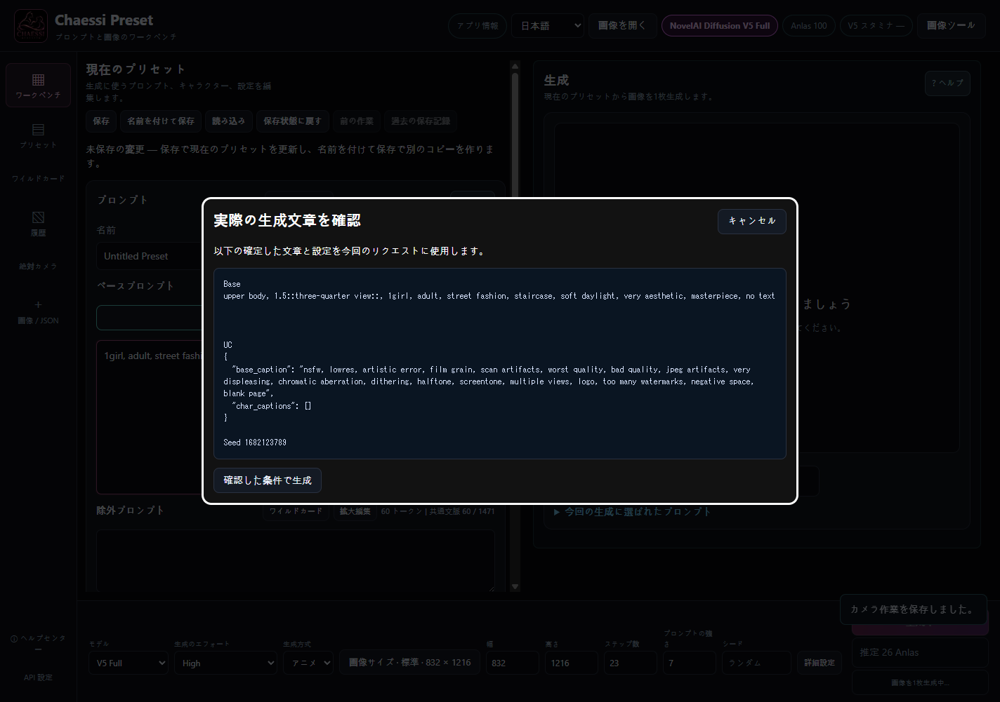
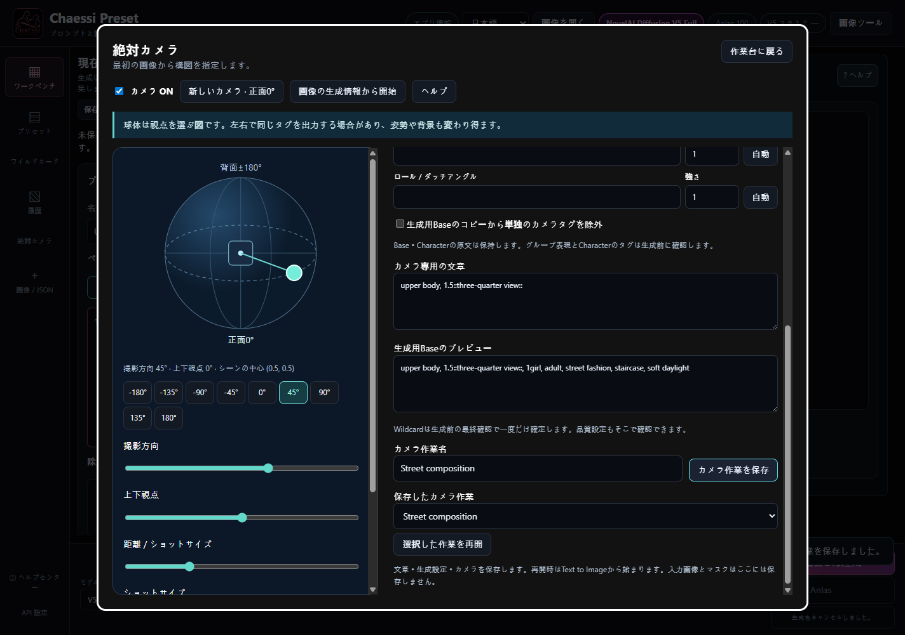

# CHAESSI PRESET v3.8.2

[オンラインカメラガイド](https://doomokddonggae.github.io/Chaessi-Preset/v3.8.2/?lang=ja&chapter=camera-absolute)

## 最初の生成から使う絶対カメラ

新規画像も既存画像も、正面0°を基準に目標の構図を指定します。

1. BaseとCharacterの文章を準備し、左の絶対カメラを開きます。元画像は不要です。
2. 起動時のカメラはOFFです。カメラONを選ぶか、新しいカメラ・正面0°で開始します。新しいカメラは正面0°・上下0°・上半身・強さ1から始まり、元画像の方向は質問しません。
3. 横ドラッグで方向、縦ドラッグで上下視点を変えます。方向ボタンと矢印キーも使えます。Homeで正面に戻ります。
4. カメラOFFでは専用文章を追加せず、通常の手動プロンプトを使用します。

v3.8.2で方向を45°、その強さを1.5に変えた例です。新しいカメラの初期値は正面0°・強さ1です。

球体は希望する視点を選ぶ操作図です。実際の場面を回転したり、個別のCharacter Positionを動かしたりしません。

## 方向・ショットサイズ・構図

各軸を個別に調整し、同じ軸の対立する方向を混ぜません。

1. 正面・斜め前・側面・斜め後ろ・背面のいずれかを出力します。左右の側面はどちらもfrom sideになる場合があります。
2. 距離スライダーか一覧でクローズアップ・上半身・太ももまで・全身・ワイドを選びます。実際の距離ではなくフレーミングです。
3. 上下視点はfrom aboveまたはfrom belowを追加します。中央の範囲では上下タグを追加しません。
4. 追加調整では撮影の高さ、左右の配置（パン）、上下に向ける視点（チルト）、画面の傾き（ロール）を文章で伝えます。画像サイズは別に選び、I2I/部分修正の元サイズは自動では変えません。

v3.8.2で方向を45°、その強さを1.5に変えた例です。新しいカメラの初期値は正面0°・強さ1です。

左右の正確さ、物理角度、独立したパン・チルト効果は保証しません。高さ・パン・チルトの文章は実験的です。

## Base専用文章と直接編集

編集中のBase原文を保持したまま、生成に使う文章を確認します。

1. ショット・方向・上下・高さ・パン・チルト・ロールの順でBaseの先頭に追加します。Characterの文章は移動も再構成もしません。
2. 各行の強さを-10～10で編集します。1は中立、0はその行を省略します。負の強調は概念を抑制・反転し、意図した方向と逆になる場合があります。
3. 文章を直接編集できます。球体を動かしても保持され、その行の自動ボタンで座標由来の文章に戻ります。
4. 1.のような未完成数値は表示を保持し、保存・生成を止めます。入力を完成させてください。強さの変更では球体は動きません。
5. 文章は300文字以内の通常のテキストで入力します。波括弧・角括弧・コロン・縦棒（|）・Wildcard・改行は使えません。強調は隣の強さで調整してください。

右側の軸別文章・強さ・自動ボタンを使います。UI言語を変えても英語のプロンプトは翻訳されません。

下へスクロールするとカメラ専用文章と生成用Baseのプレビューを確認できます。

重みは文章の強調であり、方向の混合比率ではありません。1は中立の初期値です。数値を上げても構図や品質がより正確になるとは限りません。

## 手動表現の競合と最終確認

実際に送信する文章を読んで判断します。

1. Base・Characterの明示的なカメラタグを位置とともに表示します。姿勢・頭・視線の文章を解釈して削除しません。
2. 生成用Baseから認識された単独のカメラタグを任意で除外できます。強調した単一タグも対象になる場合があります。原文は保持し、複数タグをまとめた表現とCharacterのタグは残します。
3. 作業台で生成を押すとWildcardを一度だけ確定し、品質・UCを含む最終文章を表示します。残った手動表現を保持する場合は明示的にチェックします。キャンセルして原文を編集することもできます。
4. 確認した条件で生成を押したときだけ送信します。開始後の編集は進行中のリクエストに影響しません。

競合が残っていない最終文章の確認例です。カメラタグが残る場合は追加の確認項目が表示されます。

自由文の意味上の競合をすべて検出できるわけではないため、最終文章を確認してください。カメラは構図・視点の指示を送り、結果は文章と生成モデルの解釈によって変わります。

## 画像・履歴・保存作業の再利用

新しいカメラの開始とv3.8.2作業の再開を区別します。

1. 画像の生成情報から開始で、情報を読めるPNG/WebPを選びます。文章と設定を読み込み、正面0°から始めます。I2Iは自動で使いません。
2. 履歴を開いて新しい絶対カメラを選ぶと、以前の視点に関係なく0°から始まります。旧カメラ情報は読み取り専用で確認できます。
3. v3.8.2カメラを再開は記録した状態と編集原文を復元します。v3.8.0/1の補正値は変換しません。
4. カメラ作業を保存で文章・設定・カメラを別ファイルに保存します。再起動後に選択した作業を再開できます。Text to Imageで再開するので入力画像・マスクは別に準備します。

画面の下で名前を付けて保存し、一覧で選んだ作業を再開します。

既存プリセット・履歴・旧カメラファイルは保持します。旧カメラ情報は履歴で読めますが、旧セッション・補正値の編集・再実行・変換はできません。再起動後は自動再開しないため、保存して自分で再開してください。人物・構図・背景は変わる場合があります。
