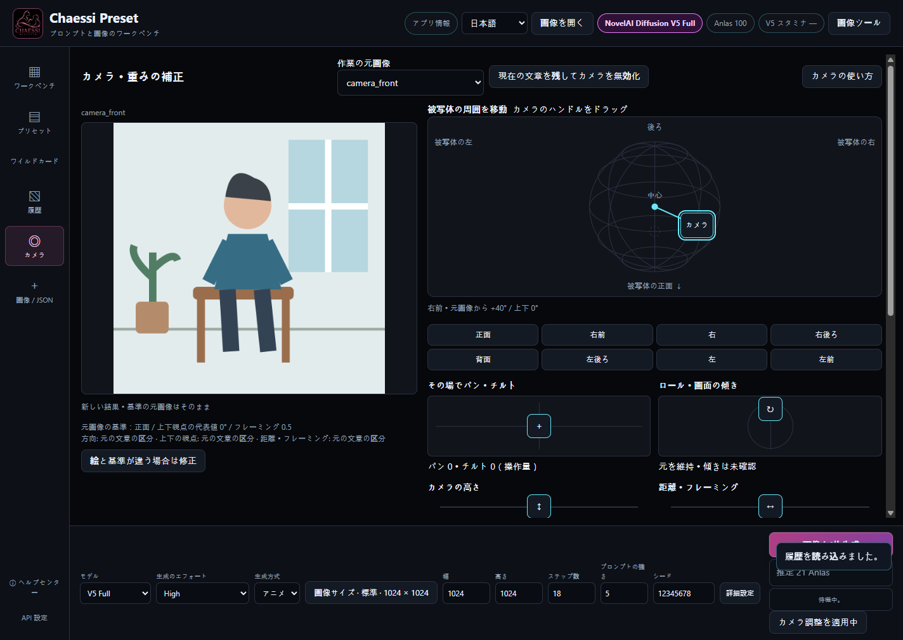
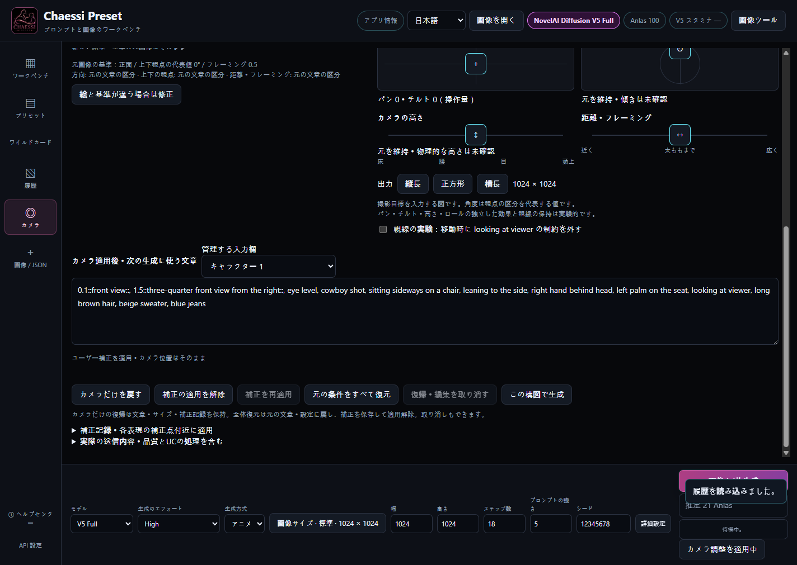
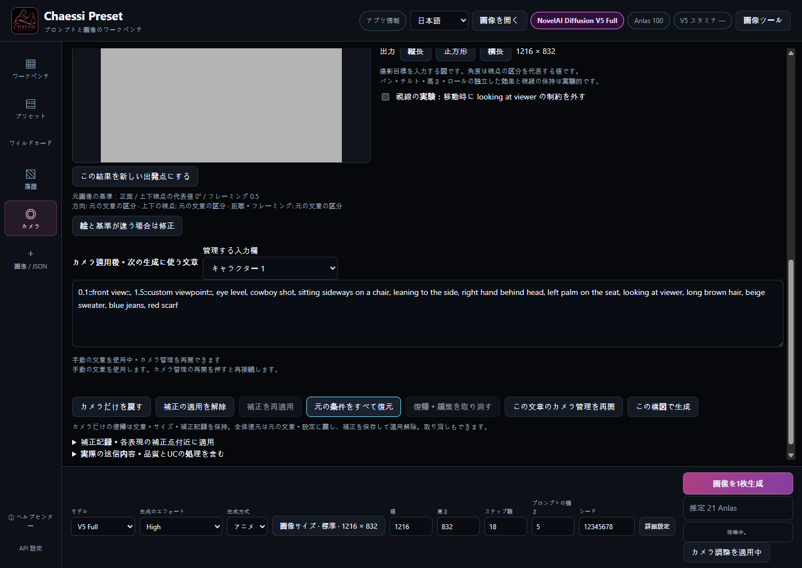

# CHAESSI PRESET 3.8.0 — 日本語

[README](../README.ja.md) · [Release](https://github.com/DooMokDdongGae/Chaessi-Preset/releases/tag/v3.8.0)

## カメラ：既存の画像から始める

生成済み画像のプロンプトと設定を使って別の構図を探します。自動対応は出発点で、自分で修正することも通常の使い方です。

1. 履歴で画像を大きく開き、「カメラで構図を探す」を押します。最新の生成結果にも同じボタンがあります。
2. 外部 PNG/WebP は「画像を開く」で NAI 生成メタデータを読み、カメラボタンを選びます。読み取れる情報がない画像を自動分析したり、プロンプトを推測したりしません。
3. 元の文章にある方向・上下の視点・フレーミングを基準にします。不足や左右が曖昧な項目だけ確認します。絵と異なる場合は「絵と基準が違う場合は修正」で直します。
4. V4.5 の資料は読み込み・編集できます。新規生成の前にワークベンチで V5 Full に明示的に切り替え、High/Medium と設定を確認してください。

3D 復元や正確な再撮影ではありません。画像を選んだだけでは I2I 入力として送信されません。元ファイルや既存の履歴は上書きしません。

## カメラ：ハンドルと方向

周囲の移動と、その場でのパン・チルトは異なる撮影目標です。図は入力用で、結果のプレビューではありません。

1. 球体のカメラハンドルをドラッグして方向と上下の視点を変えます。8方向ボタンで正面・左右の前斜め・側面・後ろ斜め・背面を選び、ドラッグで中間の方向を探します。
2. 左右は被写体を基準にしています。正面から見た画面の左右とは異なる場合があります。元画像からの変化量も確認してください。
3. パン・チルトのパッドは位置を変えずにカメラの向きを変える指定です。球体上の移動は被写体の周囲で見る位置を変えます。
4. 高さは物理的なカメラの高さ、距離・フレーミングは写す範囲、ロールは画面の傾きを指定します。縦・正方形・横は実際の出力サイズを変えます。下部の生成設定でもサイズを編集できます。

ホイールや Shift の組み合わせを知らなくても操作できます。角度は区分を代表する目標値で、生成画像の測定値ではありません。高さと上下視点も別の状態ですが、モデルが独立して反映するとは限りません。

## カメラ：現在位置で重みを補正

位置は撮影目標、重みは表現の強さです。数値を直しても角度を逆算してカメラを動かしません。

1. 正面基準から +40° の例では、正面 0.1 と前斜め 1.1 が提案されます。「カメラ適用後・次の生成に使う文章」で前斜めの数値だけ 1.5 に変えてみます。
2. カメラは +40°、正面は 0.1 のままです。合計を正規化するための再配分はしません。+50° に動かすと付近に補正が続き、+40° に戻すと 1.5 が再現されます。
3. 複数の位置を補正できます。同じ位置・表現を直すと補正が更新されます。往復しても値は累積せず、側面や背面まで前斜めの表現が付いてくることもありません。
4. 記録はその元画像の作業・モデル/Effort・入力欄・軸・表現に属します。別の元画像には伝わりません。High/Medium 切り替え時はその条件の記録を使います。補正の適用解除・再適用、または記録から個別に戻せます。

数値は操作例で、実際に +40° の画像になる保証ではありません。入力は -10～10、小数点以下3桁までです。他の軸を変えても補正した軸の位置は変わりません。

## カメラ：直接直して作業を続ける

手・服・背景・隠れる部分が意図と違う場合は文章を直接直して続けます。自動の姿勢分析や可視性推論に置き換える機能ではありません。

1. 次の生成文で管理対象の数値だけを変えると重みの補正です。人物・服装・行動・ポーズ・背景の文章も直接編集できます。
2. カメラタグの追加・削除・置換が自動管理と競合すると、手動の文章を使う状態になります。修正を優先し、ハンドルを動かしても黙って上書きしません。
3. 「この文章のカメラ管理を再開」でパネルと再接続できます。以前の文章は「復帰・編集を取り消す」で戻せます。「現在の文章を残してカメラを無効化」は有効な出力文を通常の作業台へ渡し、直接編集を続けられます。
4. 「この構図で生成」で送信します。生成中の編集は次のリクエストに適用され、送信済みの内容は開始時のスナップショットを維持します。「実際の送信内容」で品質・UC 処理後の文章も確認できます。

数値の補正と文章の構造の編集は別の操作です。未完了の構文は修正または取り消してから生成します。ドラッグ終了や編集だけで自動生成はしません。

## カメラ：入力エラーから復帰する

入力エラーがあっても作業内容は削除しません。修正または取り消して続けられます。

1. 1. のような未完了の数値や閉じていない :: は画面に残り、生成を止めます。完成させるか「現在の未完了の編集を取り消す」を押します。取り消した入力も「復帰・編集を取り消す」で復元できます。
2. 0 と負の値も -10～10 の範囲で入力できます。表現を抑制する指定になる場合があり、カメラ移動を意味しません。範囲や小数桁のエラーは案内に従って直します。
3. 基本値が小さい位置で大きく補正すると、移動後の補間値が範囲を超える場合があります。補正点に戻して値を下げるか、記録から個別に戻すか、補正の適用を解除します。黙って値を切り詰めて送信しません。
4. 混在する重みのグループはカメラ以外の内容を守るため保留されることがあります。自分で構造を整理するか手動の文章を使います。「元の条件をすべて復元」で最初に戻り、必要なら取り消せます。

別の元画像へ切り替えたり、カメラを使わない通常の作業を続けたりできます。以前の正常値を最新の入力と偽って送信しません。

## カメラ：比較・記録・復帰

元画像ごとの作業と生成結果は分けて保存します。新しい結果は比較用で、自動的に元画像を置き換えません。

1. 左で元画像と新しい結果を比べます。別の基準にするには「この結果を新しい出発点にする」を明示的に選びます。保存されたカメラ記録の再開とは別の作業です。
2. 「カメラだけを戻す」は基準位置へ戻し、文章・サイズ・補正記録は保持します。「補正の適用を解除」は位置を動かしません。記録から個別の補正も戻せます。
3. 「元の条件をすべて復元」は元の文章・シード・サイズ・生成設定に戻し、補正は保存して適用解除します。「復帰・編集を取り消す」で直前の復帰や復元を取り消します。作業の元画像一覧で別の画像へ移り、戻るとその作業を再開します。
4. ローカルデータの data/camera に元画像ごとの作業と選んだ読み込み画像を保存します。生成履歴の JSON に camera_context を追加します。この記録からの再開は補正値で角度を推定せず、保存した座標を使います。

通常の PNG/WebP だけをコピーしても、生成メタデータ以外のすべての作業・補正記録が付いてくるわけではありません。アプリデータと履歴をバックアップしてください。記録と実際の文章が矛盾する場合は自動再開しません。

## カメラ：制限と生成費用

目標の位置と表現の強さを探す道具です。モデルが場面の全条件を完全に守るとは限りません。

1. ドラッグ・重みの編集・基準の確認・比率変更だけでは生成リクエストを送りません。生成を押したときに、既存のアカウント・モデル・設定による費用案内を確認します。
2. 同じシードでも姿勢・手・腕・頭・視線・背景・物体の一貫性は保証されません。意図と違えば文章や重みを直接直して再生成します。
3. その場のパン・チルトや物理的な高さと上下視点の独立した効果は不安定な場合があります。一つずつ変えて比較してください。ロールも正確な画像角度や回転方向を保証しません。
4. 視線の実験は初期状態ではオフです。有効にして方向を十分に変えると、明確な looking at viewer の制約だけを外し、looking over shoulder など頭の姿勢の文章は保持します。視線・頭の固定を保証するものではありません。

実際の生成にはインターネットと生成権限のある NovelAI アカウントが必要で、Anlas または V5 スタミナの条件に従います。無料生成として案内しません。コード・mock・Electron の検証と画像品質の検証は別です。

