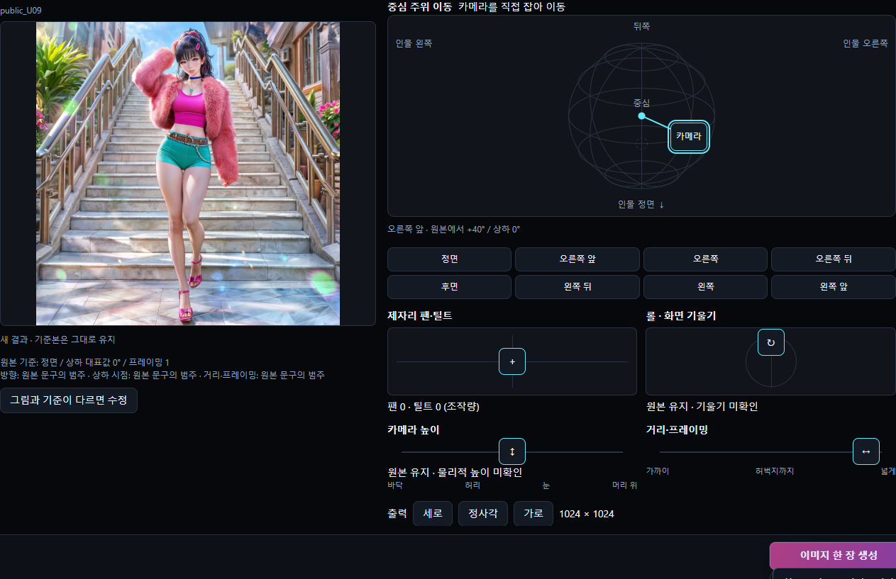
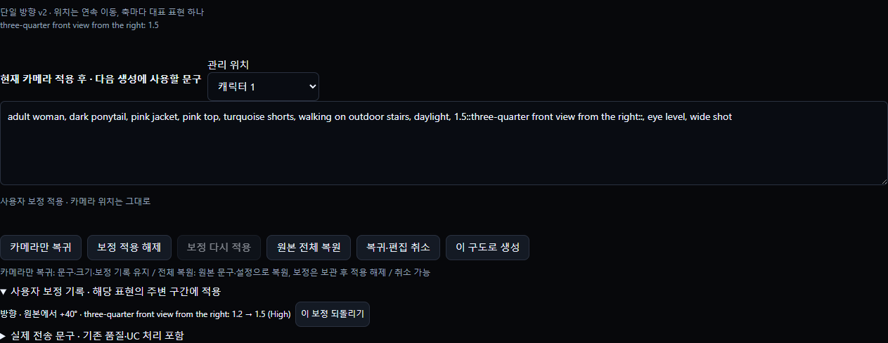
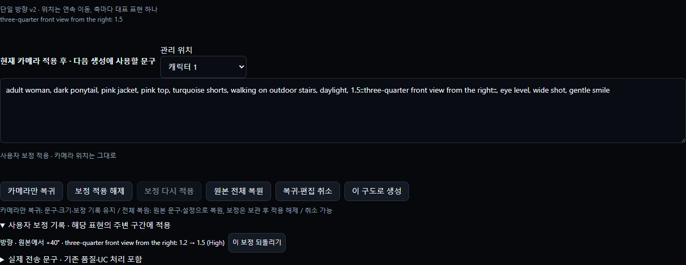

# CHAESSI PRESET v3.8.1 — KO

## 카메라: 원본에서 시작하기

이미 만든 그림의 프롬프트와 설정으로 다른 구도를 탐색합니다. 자동 대응은 출발점이며 직접 고쳐 쓰는 것이 정상적인 사용입니다.

1. History에서 그림을 크게 열고 카메라로 새 구도를 누르세요. 최근 생성 결과의 같은 버튼에서도 시작할 수 있습니다.
2. 외부 PNG/WebP는 이미지 열기에서 NAI 생성 메타데이터를 읽은 뒤 카메라 버튼을 누르세요. 메타데이터가 없으면 장면을 자동 분석하거나 프롬프트를 추정하지 않습니다.
3. 원본 문구에 있는 방향·상하 시점·프레이밍을 기준으로 삼습니다. 없는 정보나 좌우가 모호한 항목만 확인하세요. 그림과 다르면 그림과 기준이 다르면 수정에서 바로잡습니다.
4. V4.5 자료는 읽고 편집할 수 있지만 새 생성에는 작업대에서 V5 Full로 명시적으로 전환해야 합니다. 전환 후 High/Medium과 설정을 확인하세요.

그림의 3D 복원이나 정확한 재촬영 기능이 아닙니다. 원본 선택만으로 I2I 입력을 보내지 않습니다. 원본 파일과 기존 History를 덮어쓰지 않습니다.

사용자 작품을 불러온 v3.8.1 실제 화면입니다. 화면의 짧은 프롬프트는 공개용 조작 예시이며 원작 생성 원문은 공개하지 않습니다.

## 카메라: 손잡이와 방향

구체 위 위치 이동과 제자리 팬·틸트는 서로 다른 촬영 목표입니다. 도식은 입력 장치이며 결과 미리보기가 아닙니다.

1. 구체의 카메라 손잡이를 직접 끌어 좌우 방향과 상하 시점을 바꾸세요. 8방향 버튼으로 정면·양쪽 앞사선·측면·뒤사선·후면을 빠르게 선택하고, 드래그로 중간 방향을 찾습니다. 새 v2 작업은 위치를 연속 저장하되 방향·상하 시점·높이·프레이밍마다 대표 표현 하나를 선택합니다. 방향 구간은 중심각의 ±22.5°이며 시작 포함·끝 제외입니다. 경계에서 태그가 바뀌어도 손잡이 위치는 고정 각도로 튀지 않습니다.
2. 좌우 표시는 피사체 기준입니다. 정면에서 바라보는 화면의 좌우와 다를 수 있습니다. 원본에서 몇 도 이동했는지 표시를 함께 확인하세요.
3. 제자리 팬·틸트 패드는 카메라 위치를 그대로 두고 바라보는 방향을 요청합니다. 구체 이동은 피사체 주위에서 보는 위치를 바꿉니다.
4. 높이 레일은 카메라의 물리적 높이, 거리·프레이밍은 얼마나 넓게 담을지, 롤은 화면 기울기를 요청합니다. 세로·정사각·가로 버튼은 실제 출력 크기를 바꿉니다. 자세한 크기는 아래 생성 설정에서도 고칠 수 있습니다.

휠이나 Shift 조합을 몰라도 조작할 수 있습니다. 각도는 범주를 대표하는 목표값으로 실제 결과를 측정한 값이 아닙니다. 높이와 상하 시점도 별도 상태이며 모델이 항상 독립적으로 반영하지는 않습니다.

사용자 작품을 불러온 v3.8.1 실제 화면입니다. 화면의 짧은 프롬프트는 공개용 조작 예시이며 원작 생성 원문은 공개하지 않습니다.

① 사용자 원본 ② +40° 방향·상하 25° 목표로 생성한 실제 결과. 목표값은 물리 각도 측정값이 아니며 배경과 자세도 달라졌습니다.

## 카메라: 현재 위치에서 가중치 보정

카메라 위치는 촬영 목표이고, 가중치는 표현의 강도입니다. 숫자를 고쳐도 위치를 역산해서 움직이지 않습니다.

1. 새 v2 작업에서 정면 기준 +40°로 이동하면 앞사선 표현 하나가 1.2로 제안됩니다. 현재 카메라 적용 후 · 다음 생성에 사용할 문구에서 이 숫자만 1.5로 바꿔 보세요. 1.2는 비교 시험용 기본값이며 최적값으로 검증되지 않았습니다.
2. 카메라는 +40°에 그대로 있습니다. +50°에서도 같은 앞사선 구간 안에서 보정이 이어지고, +90°에서는 측면 표현 하나를 사용합니다. +40°로 돌아오면 1.5가 재현됩니다. 인접 방향을 섞거나 가중치를 각도로 역산하지 않습니다.
3. 다른 위치에도 보정할 수 있습니다. 같은 위치의 같은 표현을 다시 고치면 이전 보정을 갱신합니다. 왕복해도 누적되지 않으며 측면·후면에서 앞사선 표현이 계속 붙지는 않습니다.
4. 보정 기록은 원본별 작업의 모델/Effort·슬롯·축·표현에 연결됩니다. 다른 원본으로 전파하지 않습니다. High/Medium을 바꾸면 해당 조건의 기록을 사용합니다. 보정 적용 해제, 다시 적용 또는 기록의 개별 되돌리기로 조절하세요.

숫자는 조작 예시이며 실제 +40° 결과를 보장하지 않습니다. 지원 입력은 -10~10, 소수 셋째 자리까지입니다. 다른 축을 바꾸어도 보정한 축의 위치는 바뀌지 않습니다.

사용자 작품을 불러온 v3.8.1 실제 화면입니다. 화면의 짧은 프롬프트는 공개용 조작 예시이며 원작 생성 원문은 공개하지 않습니다.

같은 위치·같은 시드에서 방향 강도만 ① 1.2 ② 1.5로 바꾼 실제 결과입니다. 자세·시선까지 고정되지는 않았습니다.

## 카메라: 직접 고쳐서 이어가기

모델이 손·옷·배경이나 가려질 부분을 다르게 그리면 문구를 직접 고쳐 이어가세요. 자동 자세 분석이나 가시성 추론으로 대체하지 않습니다.

1. 다음 생성 문구에서 관리 중인 표현의 숫자만 바꾸면 가중치 보정입니다. 인물·의상·행동·포즈·배경 문구도 직접 수정할 수 있습니다.
2. 카메라 태그를 추가·삭제·교체해서 자동 관리와 충돌하면 수동 문구 유지 상태가 됩니다. 수정한 문구를 우선 사용하며 손잡이를 움직여도 조용히 덮어쓰지 않습니다. 다른 슬롯이나 수동 문구에 카메라 조건이 남으면 위치와 문구를 표시합니다. 원문은 유지되므로 직접 확인하고 수정하세요.
3. 다시 패널과 연결하려면 이 문구의 카메라 관리 재개를 누릅니다. 이전 문구는 복귀·편집 취소로 되찾을 수 있습니다. 카메라 비활성화는 현재 유효한 문구를 일반 작업대로 전달하므로 직접 편집을 이어갈 수 있습니다.
4. 이 구도로 생성을 눌러 요청하세요. 생성 중 편집은 다음 요청에 반영되고 전송된 요청은 당시 스냅샷을 유지합니다. 실제 전송 문구에서 기존 품질·UC 처리 후 내용도 확인할 수 있습니다.

가중치 보정과 문장 자체 수정은 다른 동작입니다. 미완성 문법은 먼저 수정하거나 취소해야 생성할 수 있으며, 손 놓기나 편집만으로 자동 생성하지 않습니다.

사용자 작품을 불러온 v3.8.1 실제 화면입니다. 화면의 짧은 프롬프트는 공개용 조작 예시이며 원작 생성 원문은 공개하지 않습니다.

## 카메라: 잘못된 입력 복구

입력 오류는 내용이 삭제되는 이유가 아닙니다. 오류를 고치거나 취소하고 같은 작업을 이어갈 수 있습니다.

1. 1.처럼 미완성인 숫자나 닫히지 않은 ::는 화면에 남고 생성이 차단됩니다. 숫자·문법을 완성하거나 현재 미완성 편집 취소를 누르세요. 취소 전 내용도 복귀·편집 취소로 복구할 수 있습니다.
2. 0과 음수도 -10~10 범위에서 입력할 수 있습니다. 이는 표현을 억제하는 요청일 수 있으며 위치 이동을 뜻하지 않습니다. 지원 범위를 넘거나 소수 자릿수가 많으면 오류 안내를 따르세요.
3. 이전 v1 계산이나 팬·틸트·롤 보정에서 이동 후 지원 범위를 넘으면 값을 낮추거나 해당 보정을 되돌리거나 보정 적용 해제를 누르세요. 값을 조용히 잘라 보내지 않습니다.
4. 혼합 가중치 묶음은 비카메라 내용을 보호하기 위해 적용 보류될 수 있습니다. 문구를 직접 정리하거나 수동 상태로 사용하세요. 전체를 다시 시작하려면 원본 전체 복원 후 필요하면 취소할 수 있습니다.

다른 원본으로 전환하거나 카메라 적용을 쓰지 않는 기존 작업을 계속할 수도 있습니다. 오류를 무시해 예전 정상값을 최신 입력처럼 보내지 않습니다.

사용자 작품을 불러온 v3.8.1 실제 화면입니다. 화면의 짧은 프롬프트는 공개용 조작 예시이며 원작 생성 원문은 공개하지 않습니다.

## 카메라: 비교·기록·복귀

원본별 작업과 생성 결과를 구분해서 보관합니다. 새 결과는 비교 대상이며 자동으로 새 원본이 되지 않습니다.

1. 왼쪽에서 원본과 새 결과를 비교하세요. 결과를 이어서 기준으로 쓰려면 이 결과를 새 출발점으로를 명시적으로 선택합니다. 저장된 카메라 기록 재개와는 별도 작업입니다.
2. 카메라만 복귀는 원본 기준 위치로 돌아가고 문구·크기·보정 기록은 유지합니다. 보정 적용 해제는 위치를 움직이지 않습니다. 개별 보정도 기록에서 되돌릴 수 있습니다.
3. 원본 전체 복원은 원래 문구·시드·크기·생성 설정을 복원하고 보정은 보관한 채 적용 해제합니다. 복귀·편집 취소는 직전 복귀나 복원을 취소합니다. 작업 원본 목록에서 다른 원본으로 갔다 돌아오면 해당 작업을 재개합니다.
4. 로컬 데이터 폴더의 data/camera에 원본별 작업과 선택한 가져오기 이미지가 저장됩니다. 생성 결과의 History JSON에는 camera_context가 추가됩니다. 이 기록으로 재개할 때는 보정 숫자에서 각도를 다시 추정하지 않습니다. 이전 v1 작업과 History는 당시 혼합 계산으로 재개됩니다. 새 단일 방향 작업으로 복사를 누르면 미리보기에서 가져올 보정을 선택할 수 있습니다. 같은 원본·모델/Effort·슬롯·표현·위치에 맞는 절대값만 가져오며, 선택 불가 기록은 이전 작업에 남습니다. 취소는 아무것도 바꾸지 않고, 적용하면 별도 v2 작업이 저장됩니다. v2에서도 이전 보정 선택 가져오기와 복귀·편집 취소를 사용할 수 있습니다.

일반 PNG/WebP만 복사하면 생성 메타데이터는 읽을 수 있어도 모든 카메라 작업·보정 기록이 따라가는 것은 아닙니다. 앱 데이터와 History를 백업하세요. 저장된 기록과 실제 문구가 충돌하면 자동 재개하지 않습니다.

사용자 작품을 불러온 v3.8.1 실제 화면입니다. 화면의 짧은 프롬프트는 공개용 조작 예시이며 원작 생성 원문은 공개하지 않습니다.

## 카메라: 한계와 생성 비용

원하는 위치와 표현 강도를 탐색하는 도구입니다. 모델이 모든 장면 조건을 완벽히 지키지는 못합니다.

1. 드래그·가중치 편집·초기 기준 확인·비율 변경만으로는 요청하지 않습니다. 생성 버튼을 눌렀을 때 기존 계정·모델·설정에 따른 비용 안내를 확인합니다.
2. 시드가 같아도 자세·손·팔·고개·시선·배경·사물의 일관성을 보장하지 않습니다. 실제 결과가 다르면 문구나 가중치를 직접 고쳐 다시 생성하세요.
3. 제자리 팬·틸트, 물리적 높이와 상하 시점의 독립 효과는 불안정할 수 있습니다. 한 값씩 바꾸어 비교하세요. 롤도 실제 각도와 회전 방향을 정밀 보장하지 않습니다.
4. 시선 실험은 기본 꺼짐입니다. 켜면 충분히 방향을 옮겼을 때 명확한 looking at viewer 제약만 해제하며 looking over shoulder 같은 고개 자세 문구는 유지합니다. 이것도 시선·고개 고정을 보장하지 않습니다.

실제 생성에는 인터넷과 NovelAI 계정·생성 권한이 필요하며 Anlas 또는 V5 Stamina 조건을 따릅니다. 무료 생성으로 소개하지 않습니다. 코드·mock·Electron 동작 검증과 모델의 이미지 품질 검증은 서로 다릅니다.

사용자 작품을 불러온 v3.8.1 실제 화면입니다. 화면의 짧은 프롬프트는 공개용 조작 예시이며 원작 생성 원문은 공개하지 않습니다.
