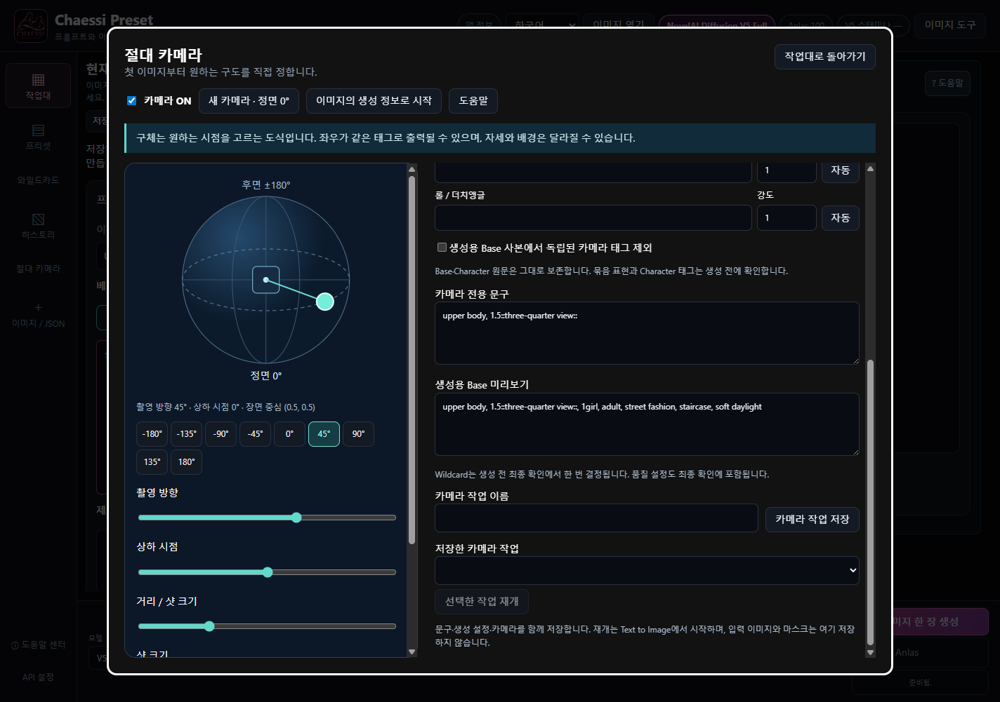
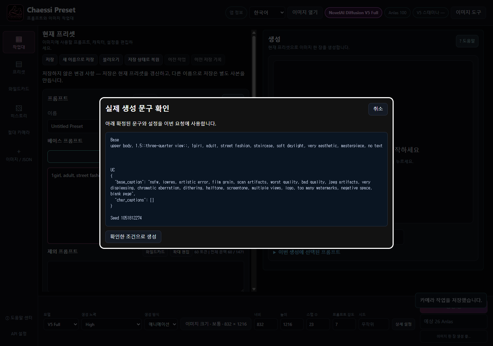
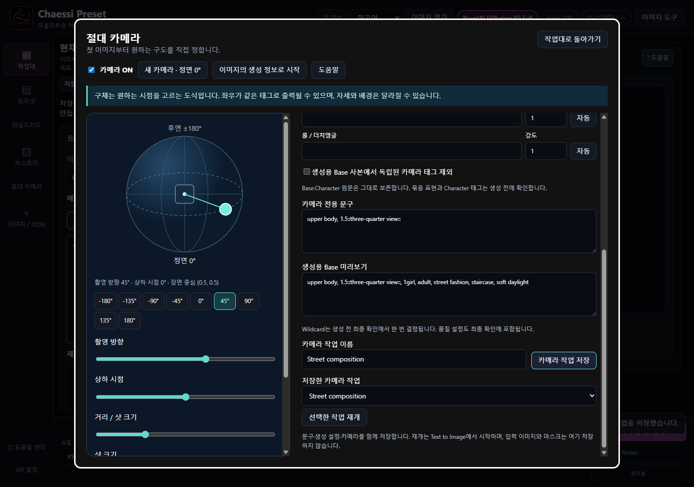

# CHAESSI PRESET v3.8.2

[온라인 카메라 도움말](https://doomokddonggae.github.io/Chaessi-Preset/v3.8.2/?lang=ko&chapter=camera-absolute)

## 첫 생성부터 쓰는 절대 카메라

새 이미지와 기존 이미지 모두 정면 0°를 기준으로 원하는 구도를 지정합니다.

1. 작업대에 Base와 Character 문구를 준비하고 왼쪽 절대 카메라를 누릅니다. 원본 이미지 없이 바로 사용할 수 있습니다.
2. 앱을 새로 실행하면 카메라는 OFF입니다. 카메라 ON을 선택하거나 새 카메라 · 정면 0°를 눌러 시작하세요. 새 카메라는 정면 0°·상하 0°·상반신·강도 1로 시작하며 원본 이미지의 방향을 묻지 않습니다.
3. 구체를 좌우로 끌면 방향, 위아래로 끌면 상하 시점이 바뀝니다. 방향 버튼과 키보드 화살표도 사용할 수 있습니다. Home은 정면으로 돌아갑니다.
4. 카메라 OFF를 선택하면 카메라 전용 문구를 추가하지 않고 기존 수동 프롬프트로 생성합니다.

v3.8.2에서 방향을 45°, 방향 강도를 1.5로 바꾼 예시입니다. 새 카메라의 초기값은 정면 0°·강도 1입니다.

구체는 원하는 시점을 고르는 조작 도식입니다. 실제 장면을 회전시키거나 개별 Character Position을 움직이지 않습니다.

## 방향·샷 크기·구도

서로 다른 축을 따로 조절하고 같은 축의 상충 표현을 섞지 않습니다.

1. 방향은 정면·앞사선·측면·뒤사선·후면 중 하나로 출력됩니다. 좌우 측면은 모두 from side를 사용할 수 있습니다.
2. 거리 / 샷 크기를 움직이거나 목록에서 클로즈업·상반신·허벅지·전신·넓은 샷을 선택합니다. 실제 미터 단위 거리가 아닙니다.
3. 상하 시점은 from above 또는 from below로 표현합니다. 중앙 구간에는 상하 태그를 추가하지 않습니다.
4. 추가 구도 조절에서 높이·팬·틸트·롤을 사용합니다. 높이는 촬영 높이, 팬은 좌우 배치, 틸트는 위아래로 향하는 시점, 롤은 화면 기울기 의도를 문구로 전달합니다. 이미지 크기는 별도로 선택하며 I2I/Inpaint의 원본 크기는 자동 변경하지 않습니다.

v3.8.2에서 방향을 45°, 방향 강도를 1.5로 바꾼 예시입니다. 새 카메라의 초기값은 정면 0°·강도 1입니다.

좌우 구별, 정밀한 물리 각도, 팬·틸트의 독립 효과는 보장되지 않습니다. 높이·팬·틸트는 실험적 문구입니다.

## Base 전용 문구와 직접 편집

편집 중인 Base 원문은 그대로 두고, 생성할 때 사용할 문구를 확인합니다.

1. 카메라 문구는 샷 크기 → 방향 → 상하 → 높이 → 팬 → 틸트 → 롤 순서로 Base 앞에 붙습니다. Character 문구를 이동하거나 재작성하지 않습니다.
2. 각 행에서 강도를 수정합니다. 1은 중립값이며, -10~10의 수를 입력할 수 있습니다. 0은 그 행을 생략하며 음수는 개념 억제·반전을 의도하므로 원하는 방향과 달라질 수 있습니다.
3. 문구 칸에서 직접 표현을 바꿀 수 있습니다. 직접 쓴 문구는 구체를 움직여도 유지되며 해당 행의 자동 버튼으로 좌표 기반 표현에 돌아갑니다.
4. 1. 같은 미완성 숫자는 오류로 표시되고 생성·저장을 막습니다. 숫자를 완성하거나 고치세요. 강도 수정은 구체 위치를 바꾸지 않습니다.
5. 문구는 300자 이내의 일반 텍스트로 입력하세요. 중괄호·대괄호·콜론·세로줄(|), Wildcard, 줄바꿈은 사용할 수 없습니다. 강조는 옆 강도 칸에서 조절합니다.

오른쪽의 축별 문구·강도와 자동 버튼을 사용합니다. 영어 프롬프트는 UI 언어를 바꿔도 번역되지 않습니다.

아래로 스크롤하면 카메라 전용 문구와 생성용 Base 미리보기를 확인할 수 있습니다.

가중치는 문구를 강조하는 값이며 방향을 섞는 비율이 아닙니다. 1은 기본 중립값입니다. 숫자를 높인다고 구도나 품질이 더 정확해지는 것은 아닙니다.

## 수동 표현 충돌과 생성 전 확인

실제 전송할 문구를 읽고 결정합니다.

1. 기존 Base·Character의 명시적인 카메라 태그를 찾으면 위치와 문구를 표시합니다. 포즈·고개·시선 문장을 임의로 해석해 삭제하지 않습니다.
2. 선택적으로 생성용 Base에서 정확히 인식한 독립 카메라 태그만 제외할 수 있습니다. 강조가 붙은 단일 태그도 해당할 수 있습니다. 원문은 보존하고, 여러 태그를 함께 묶은 표현과 Character의 태그는 남겨 둡니다.
3. 작업대로 돌아와 Generate를 누르면 Wildcard가 한 번 결정되고 품질·UC를 포함한 최종 문구가 표시됩니다. 남은 수동 표현을 유지하려면 명시적으로 체크합니다. 취소하고 원문을 고칠 수도 있습니다.
4. 확인한 조건으로 생성을 눌렀을 때만 전송합니다. 요청이 시작된 뒤 바꾼 값은 진행 중인 요청에 영향을 주지 않습니다.

충돌이 없는 최종 문구 확인 예시입니다. 남는 카메라 태그가 있으면 추가 확인 항목이 나타납니다.

자유 문장 전체의 의미 충돌은 자동으로 판정할 수 없으므로 최종 문구를 읽어 보세요. 카메라는 구도·시점에 관한 지시를 전달하며, 실제 결과는 프롬프트와 생성 모델의 해석에 따라 달라집니다.

## 이미지·History·저장 작업 재사용

새 카메라 시작과 저장한 v3.8.2 작업 재개를 구분합니다.

1. 이미지의 생성 정보로 시작에서 메타데이터가 있는 PNG/WebP를 선택합니다. 문구·설정을 가져오고 정면 0°의 새 카메라로 시작합니다. 자동 I2I는 사용하지 않습니다.
2. History를 크게 열고 새 절대 카메라를 누르면 이전 촬영 방향과 관계없이 정면 0°에서 시작합니다. 과거 카메라 기록은 읽기 전용으로 확인할 수 있습니다.
3. v3.8.2 카메라 재개는 해당 버전의 History에 저장된 카메라와 원래 편집 문구를 복원합니다. 과거 v3.8.0/1 보정값은 변환하지 않습니다.
4. 카메라 작업 저장은 문구·설정·카메라를 별도 파일로 저장합니다. 종료 후 선택한 작업 재개로 불러옵니다. 재개는 Text to Image이며 입력 이미지·마스크는 따로 준비합니다.

화면 아래에서 이름을 정해 저장하고 목록에서 선택한 작업을 재개합니다.

기존 프리셋·History·과거 카메라 파일은 보존됩니다. 구형 카메라 기록은 History에서 읽을 수 있지만 이전 세션·보정값의 편집·재실행·변환은 지원하지 않습니다. 앱 재시작 후 자동 재개하지 않으므로 작업을 저장하고 직접 재개하세요. 결과의 인물·구도·배경은 달라질 수 있습니다.
